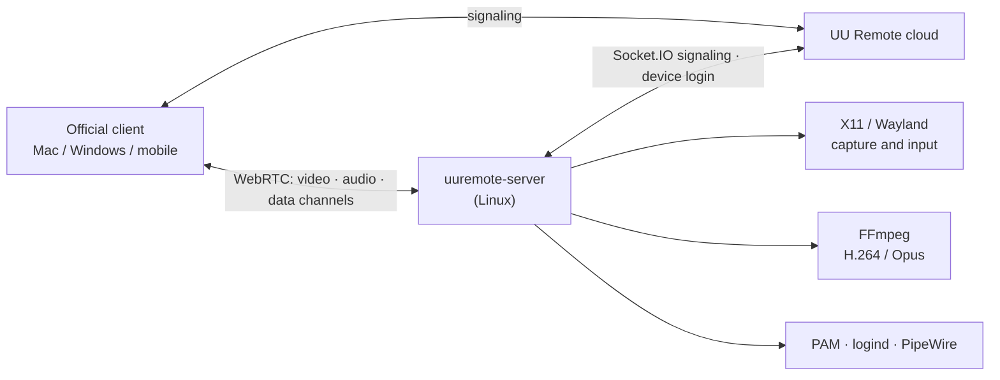

# uu-remote-linux · Unofficial Linux host for NetEase UU Remote

[简体中文](README.md) | **English**

> **A note first**
>
> NetEase UU Remote (网易 UU 远程) is a great remote-desktop tool, but there is no Linux version on its
> official website. So, with the help of Claude and Codex, I wrote this open-source Linux host: install it,
> and you can control your Linux machine from the official Mac / Windows / mobile UU Remote clients.
>
> This is a personal hobby project. **It is not affiliated with NetEase and is not an official client.**
> If NetEase considers this project infringing or inappropriate, please DM me on X
> **[@ai_fengshou](https://x.com/ai_fengshou)** and I will take it down right away.

<p align="center"></p>
<p align="center"><sub>The QR login window shown on first run (QR code blurred). The UI is in Chinese, like the official app.</sub></p>

<!-- Screenshot placeholder: the Linux desktop controlled from the official client. Take your own
     screenshot, remove account/device details and NetEase logos, save it as docs/images/remote-desktop.png
     and uncomment the next line. -->
<!-- <p align="center"></p> -->

## What it is

- A native Linux program written in Rust: no Wine, no Windows or macOS components.
- Log in by scanning a QR code with your own UU Remote account. The Linux machine then appears in the
  official clients' device list and is used just like a Windows host.
- **Host only.** To control other machines you still use the official Mac / Windows / mobile apps.

## Features

| Feature | Notes |
|---|---|
| Main window and QR login | One window with "This device" (remote assistance) and "Account": a QR code before sign-in, the account and a sign-out button after; `login --no-gui` prints the QR in a terminal |
| Remote assistance (experimental) | Like the official client: share the **device ID + verification code**; the other person enters them under 开始协助 in UU Remote. Works before sign-in (guest identity) and after; see below |
| Remote desktop | H.264 video, NVENC hardware encoding on NVIDIA GPUs, libx264 otherwise; the viewer draws its local pointer, so there is no double cursor |
| Mouse / keyboard | Absolute and relative motion, clicks, wheel, keys; no spurious key repeat on high-latency links; optional uinput virtual devices on Wayland (layout independent, see below) |
| Mac shortcuts | **Recommended**: turn off 「使用 macOS 快捷键」 (use macOS shortcuts) in the Mac viewer's remote-window menu; then Cmd+C/V/A/F/X/Z work as on a Mac (Cmd+C/V become Ctrl+Shift+C/V in terminals) and Ctrl+C always interrupts. With the option on, the viewer sends Cmd as Ctrl: in a terminal Ctrl+V / Cmd+V paste, Ctrl+C interrupts, copy is Cmd+Shift+C (X11) |
| Pointer shape | Remote cursor shape is mirrored to the viewer (X11) |
| Clipboard | Two-way text sync |
| Quality / frame rate / resolution | Auto, Original 20M, Ultra 8M, HD 2M, custom; 30/60/90/144 fps; "other resolutions" are scaled by the encoder, the host monitor is left untouched |
| Sound | System audio captured from PulseAudio / PipeWire and sent as Opus |
| File transfer | Upload, download (including folders), create folder, rename, delete |
| Terminal | The official "Terminal" tool, PTY sessions, multiple sessions, rename |
| Lock state and auto unlock | Lock state is reported to the viewer; with "auto unlock" enabled in the client, the password is verified with PAM and the session is unlocked |
| Lock after remote session | Stored on the host, so it still applies after reconnecting |
| Mute host while controlled | Host speakers are muted while the viewer still hears the sound; the previous mute state is restored afterwards |
| System actions | Lock, show desktop, task manager (system monitor), reboot, shut down |
| Port mapping | The official "port mapping" tool: forwards a local port on the viewer to an address reachable from the Linux host (e.g. 127.0.0.1:22); `UU_PORT_MAPPING=0` disables it |
| Reconnects | Every tool window has its own connection; they do not disturb each other |
| Headless servers | Goes online without a monitor with terminal, file transfer and port mapping; an Xvfb virtual desktop gives a full remote desktop (see below) |

Desktop connection boundaries and host startup clear stale input; delayed events
from an old desktop cannot affect its replacement. X11 clears pressed state on
the authenticated display (including physical keys whose origin it cannot
distinguish); uinput clears only this host's virtual devices, and Portal only its
authorized session. Independent file/terminal tool peers do not reset input.

## Supported Linux desktops

| Desktop | Display protocol | Status | Build |
|---|---|---|---|
| GNOME (Ubuntu 24.04) | X11 / Xorg | ✅ In daily use on real hardware; every feature above accepted | default |
| KDE Plasma | X11 | ✅ Tested in a VM | default |
| Xfce | X11 | ✅ Tested in a VM | default |
| Cinnamon / MATE | X11 | ✅ Tested in a VM | default |
| Hyprland | Wayland (native wlroots protocols) | 🧪 Experimental, tested in a VM (some features limited, see below) | `--features wayland` |
| GNOME / KDE Plasma | Wayland (xdg-desktop-portal) | 🧪 Experimental; validation scope and limits below | `--features wayland,portal` |

The GNOME Wayland Portal/EIS path has been checked for video and mouse/keyboard input on Ubuntu 26.04, GNOME 50, with one 4K screen at 200% scale; auto unlock after a cold locked connection is verified with the official Mac viewer, while other lock recovery and reconnection still need hardware acceptance testing. Apart from that path and GNOME on X11, desktop testing has primarily used virtual machines. If something goes wrong on
real hardware, please [open an issue](../../issues) with your distribution, desktop, GPU and the relevant lines from
`journalctl --user -u uuremote-native.service`.

Wayland limits: single screen, fixed resolution. The native Hyprland backend now pipelines two shm screencopy buffers and passes the viewer's requested fps to both capture pacing and the encoder. Actual fps remains limited by the compositor, rendering and readback (the old serial path measured about 16–22 fps at 2560x1600; the pipeline is VM-measured only, not a hardware guarantee). The portal backend does not support dynamic resolution; see below for GNOME wake and lock recovery; the clipboard syncs while the viewer's remote window has focus. On the first connection the desktop asks for "Remote Desktop / Screen Sharing"
permission; the permission is remembered once granted.

Scaled GNOME desktops using native Portal input use EIS on the same authorized session when `ConnectToEIS` and a screen `mapping_id` are available. Each axis is mapped using the matched region and actual frame dimensions, with no fixed resolution or scale factor. This avoids scaled-coordinate rejection by `NotifyPointerMotionAbsolute`. Portal builds require libei >= 1.1. Missing EIS support retains the legacy input path and its existing scaling limitations; other initialization failures are reported and trigger session recovery. After a successful EIS connection, all input uses EIS. Capture alone and uinput do not initialize EIS; missing optional logical dimensions do not block capture. Keyboard input uses the existing Windows VK to evdev mapping. Recovery keeps the encoder frame dimensions fixed but accepts logical-size changes after scaling. A previously streaming Portal capture that stays paused without a negotiated format for five seconds enters session recovery; a static desktop does not trigger this timeout. Tested while connected on Ubuntu 26.04, GNOME Wayland, one 3840x2160 display: 200% -> 166.67% -> 200%, with continuously updating video and full-screen pointer control after recovery. Switching briefly freezes and goes black before recovering; five seconds is the detection threshold, not the total recovery time. Lock recovery still needs hardware acceptance testing; multi-monitor support, live resolution changes, and rotation/reflection transforms are outside this fix's scope. Capture settings remain at protocol version 4: advertised resolutions use pixel coordinates and DPR 1; Portal logical dimensions are used only for local input mapping.

GNOME Portal CONTROL no longer waits for a consent dialog or the first video frame. It announces the selected desktop before reporting secure-desktop state and receiving the official viewer's “auto unlock host” request. The official Android viewer requires this desktop selection before entering its auto-unlock flow, so the notification must precede capture readiness; actual screen dimensions, codec information and capture permissions still follow their real readiness state. Enable auto unlock in the viewer and use the current Linux user's login password. The host verifies it with PAM, unlocks the existing GNOME session, requests display wake, and restores capture, input and clipboard through the shared Portal session. Initial consent or revoked permissions still require local approval. Reconnect if physical or logical dimensions change.

The host also accepts a desktop connection when the service started on an unlocked desktop (no Portal yet) and the screen was locked afterwards (a cold connection): it reports the lock state and accepts auto unlock, then restores picture, input and clipboard after unlock. Verified on Ubuntu GNOME Wayland with the official Mac viewer; the official iPhone 4.42.0 does not send the auto-unlock request in this scenario and is unresolved ([#29](../../issues/29)). **Limitation**: without 「自动解锁被控端」 (auto unlock) enabled, the locked screen stays black and the unlock page cannot be activated; in the UU client use 控制中心 → 安全 → 自动解锁被控端 and enter the password to unlock. With no saved Portal permission GNOME refuses to create a session while locked, so the picture only appears after unlock.

The five-minute screen-off and lock settings remain unchanged. Only capture recovery in an unlocked session temporarily holds a GNOME idle inhibitor; the first frame, lock, disconnect or initialization failure releases it. An idle viewer still allows the normal screen-off and lock timeout, and manual lock remains effective. Desktop input is blocked and video is hidden while locked or when lock state is unknown. Independent terminal, file-transfer and port-mapping peers do not wait for video initialization and survive desktop reconnection. Automated protocol and lifecycle regression tests cover this path; auto unlock and capture recovery after a cold locked connection are verified on GNOME hardware with the official Mac viewer, while screen-off and the other scenarios still need acceptance testing. Waking a fully suspended or hibernating machine is outside this CONTROL path.

The native Wayland backend needs `wlr-output-power-management` from the compositor to wake a turned-off screen; without it only wake is unavailable — capture and encoding are unaffected.

Native Wayland experiments: `UU_WAYLAND_PIPELINE=0` disables pipelining for comparison.
`UU_WAYLAND_DMABUF=1` explicitly tries dma-buf → GBM CPU mapping (off by default;
requires runtime libgbm; `UU_WAYLAND_DMABUF_DEVICE` overrides `/dev/dri/renderD128`).
Only single-plane 8-bit RGB with an advertised linear modifier is supported;
failure falls back to SHM. The virgl VM verified fallback only: successful import,
mapping and hardware acceleration remain unverified. This is not zero-copy VAAPI;
`UU_VIDEO_ENCODER=vaapi` still uploads CPU frames through FFmpeg.

## Not implemented / not supported

| Feature | Status |
|---|---|
| Switching between multiple monitors | In progress |
| True color (4:4:4) | Supported (v0.1.15): the default FFmpeg pipeline with NVENC / libx264 encodes H.264 High 4:4:4; VAAPI and `inproc-av` stay 4:2:0 and report that to the client |
| HDR | Not implemented |
| Super screen / virtual display | Not implemented |
| Privacy screen on the host | Not implemented |
| Microphone (viewer audio played on the host) | Not implemented (needs a virtual sound card) |
| Plugins such as the WoW queue notifier | Not supported; the client is told that no plugins exist |
| Linux login screen | The system login screen (before anyone logs in to the Linux desktop) cannot be controlled yet; use headless mode or a virtual desktop (see below). This is about the Linux login: **without a UU account** the host can now be used through remote assistance |
| Relay connections on restrictive networks | Uses the ICE servers provided by the UU cloud; complex network setups are not thoroughly tested |
| Acting as a viewer (controlling other machines from Linux) | Out of scope |

## Installation

### 1. Dependencies (Ubuntu / Debian)

```sh
sudo apt install build-essential pkg-config \
    libx11-dev libxext-dev libxtst-dev libxfixes-dev \
    libgtk-3-dev ffmpeg
# optional: Wayland backend
sudo apt install libwayland-dev libxkbcommon-dev wl-clipboard
# optional: GNOME/KDE portal backend
sudo apt install libglib2.0-dev libpipewire-0.3-dev libei-dev
```

- A Rust toolchain is required (<https://rustup.rs>).
- `libgtk-3-dev` is optional. Without GTK, login works with a QR code in the terminal (`UU_NO_GTK=1` disables
  the login window explicitly).
- On NVIDIA GPUs use an FFmpeg build with `h264_nvenc`; otherwise the CPU encoder (libx264) is used.

### 2. Build

```sh
cargo build --release                             # X11
cargo build --release --features wayland          # + Hyprland
cargo build --release --features wayland,portal   # + GNOME/KDE on Wayland
```

### 3. Log in

Run inside your graphical session:

```sh
./target/release/uuremote-server login
```

Scan the code with the **NetEase UU Remote mobile app** and confirm. Credentials are stored only on this
machine, in `~/.config/uuremote/config.json` (mode 0600).

### 4. Run as a user service

`~/.config/systemd/user/uuremote-native.service`:

```ini
[Unit]
Description=UU Remote Linux host (unofficial)
After=graphical-session.target

[Service]
Environment=RUST_LOG=info
# X11 desktops need the display; on GNOME, XAUTHORITY is usually /run/user/<uid>/gdm/Xauthority
Environment=DISPLAY=:0
ExecStart=%h/.local/bin/uuremote-server
Restart=always
RestartSec=5

[Install]
WantedBy=default.target
```

```sh
install -Dm755 target/release/uuremote-server ~/.local/bin/uuremote-server
systemctl --user daemon-reload
systemctl --user enable --now uuremote-native.service
journalctl --user -u uuremote-native.service -f   # online once you see availability=Some("ready")
```

If you have not logged in yet, the service opens the QR login window on your desktop.

### 5. uinput virtual keyboard/mouse on Wayland (recommended)

On Wayland (especially GNOME/KDE via the portal) the default input path needs portal consent and some keyboard layouts
drop symbols such as the underscore. Once the logged-in user may access `/dev/uinput`, the host switches to kernel
virtual devices that send physical key codes:

```sh
echo 'KERNEL=="uinput", SUBSYSTEM=="misc", OPTIONS+="static_node=uinput", TAG+="uaccess"' | \
    sudo tee /etc/udev/rules.d/60-uu-remote-linux-uinput.rules
sudo udevadm control --reload && sudo udevadm trigger --name-match=uinput
```

`uaccess` grants access only to the user sitting at the machine. `UU_INPUT_BACKEND=uinput|native` forces a backend.
X11 keeps XTest by default because it handles held keys correctly on high-latency links.

## Remote assistance and the main window (experimental)

As in the official client, this host shows a **device ID** and a **verification code**; whoever you give them to can
connect from 开始协助 (remote assistance) in UU Remote.

- **Not signed in**: the main window opens at start, offers remote assistance as a guest and shows the sign-in QR code.
  Signing in switches to account mode automatically.
- **Signed in**: the host is in your device list and remote assistance keeps working (same device ID). A background
  service keeps the window hidden; open it with `uuremote-server show` or the "UU Remote Linux Host" launcher.
  Closing the window only hides it.
- **Tray icon**: a background host shows a tray icon with Open main window, the allow switch and Quit. GNOME needs
  the AppIndicator extension (bundled on Ubuntu); Xfce / Cinnamon / KDE work as is. Quit stops `uuremote-native.service`;
  the launcher starts it again.
- **Settings** (as in the official client): allow switch (off by default); verification by temporary code, custom code
  (8–16 letters and digits) or either; temporary code rotation after each session / hourly / 12 h / 24 h / never;
  copy buttons for the ID and the code. Stored in the 0600 config.
- The code is only shown in the local window, never logged. Without a desktop, `uuremote-server assist` shows it on the
  terminal (`allow` / `deny` / `reset` / `mode …` / `refresh …` / `off`).
- **Security**: the ID and code give full control (desktop, files, terminal). Share them only with people you trust.

Optional launcher icon:

```sh
install -Dm644 contrib/desktop/uu-remote-linux.svg ~/.local/share/icons/hicolor/scalable/apps/uu-remote-linux.svg
install -Dm644 contrib/desktop/uu-remote-linux.desktop ~/.local/share/applications/uu-remote-linux.desktop
```

Verified with the official Mac viewer: guest connections, wrong-code rejection, code rotation, switching assistance off,
signing in and out. **Remote assistance while signed in has not yet been tested from a different account** (devices of
the same account cannot assist each other, an official restriction).

## Servers without a monitor

**Headless mode** (terminal, file transfer and port mapping only): add `Environment=UU_DESKTOP_BACKEND=none` to the
service and run `loginctl enable-linger $USER`, so the systemd user manager (with `XDG_RUNTIME_DIR` and the user D-Bus)
starts at boot without a login. The viewer's remote desktop keeps showing "connecting" in this mode; that is expected.
Log in once with `uuremote-server login --no-gui` (QR in the terminal).

**Virtual desktop**: for a full remote desktop, run a desktop session (Xfce recommended) on an Xvfb screen:

```sh
sudo apt install xvfb xauth x11-utils dbus-x11 dbus-user-session xfce4      # or another session, chosen with UU_VIRTUAL_SESSION
install -Dm755 contrib/virtual-desktop/uu-virtual-desktop ~/.local/bin/uu-virtual-desktop
install -Dm644 contrib/virtual-desktop/uu-virtual-desktop.service ~/.config/systemd/user/uu-virtual-desktop.service
install -Dm644 contrib/virtual-desktop/virtual-display.conf ~/.config/systemd/user/uuremote-native.service.d/virtual-display.conf
loginctl enable-linger $USER
systemctl --user daemon-reload && systemctl --user enable --now uu-virtual-desktop.service
systemctl --user restart uuremote-native.service
```

The virtual screen is `:99`, 1920x1080 by default. Xvfb has no GPU acceleration, so it is a little less smooth than a
real display; NVENC is still used for encoding when an NVIDIA GPU is present. The script exports `DISPLAY` to the
systemd user session so D-Bus-activated programs open on the virtual screen; on a machine that also runs a real desktop
session set `UU_VIRTUAL_BUS=private` so the real session is not affected.

To make a GPU drive a real (non-Xvfb) desktop without a monitor, use a dummy HDMI plug or load an EDID file with the
kernel parameter `drm.edid_firmware=`, then install as for a normal X11 desktop.

## Configuration

Common environment variables:

| Variable | Purpose |
|---|---|
| `UU_CONFIG` | Config file path (default `~/.config/uuremote/config.json`) |
| `UU_DESKTOP_BACKEND` | `auto` / `x11` / `wayland` / `portal` / `kms` (experimental feature) / `none` (headless) |
| `UU_INPUT_BACKEND` | `auto` (default: uinput on Wayland when accessible) / `uinput` / `native` |
| `UU_TERMINAL_SHORTCUTS=0` | Disable the Ctrl+V paste rewrite in terminal windows |
| `UU_VIDEO_ENCODER` | `cpu`: libx264; `vaapi`: opt-in Intel/AMD; `nvenc`: force NVENC; unset: NVENC only when an NVIDIA driver is loaded, else CPU |
| `UU_FFMPEG_ROOT` | Use FFmpeg from this prefix |
| `UU_AUDIO=0` | Disable sound; `UU_AUDIO_SOURCE` picks the PulseAudio source |
| `UU_REMOTE_ASSIST=0` | Disable remote assistance (no guest assistance before sign-in either) |
| `UU_ASSIST_ALLOW=1` | Allow remote assistance at start (overrides the saved switch) |
| `UU_LOGIN_WINDOW=0` | Do not open the login window automatically when credentials are missing |
| `UU_PORT_MAPPING=0` | Disable port mapping (the official host's controlled-side switch) |

Host settings such as "lock after remote session" and "mute host" are stored in
`~/.config/uuremote/host_settings.json`.

With external FFmpeg CPU encoding, the bitrate presets (Original / Ultra / HD / custom) use average bitrate (ABR) to avoid gray keyframes at 4K and low bitrates; Auto keeps constant rate factor (CRF).

## Let an AI agent install or develop it

If you use Claude Code, Codex, Cursor or a similar coding agent, have it read [AGENTS.md](AGENTS.md) first.
It is written for language models: build and install steps, a code map, protocol notes and development rules,
enough to take over installation or development.

For local encoding diagnostics, `desktop-video-probe [output.h264]` accepts `UU_PROBE_FPS`, `UU_PROBE_FRAMES` (default 5), and `UU_PROBE_QUALITY` (1–5); set `UU_PROBE_INPUT=clip.y4m` (also `.mp4` or `frames/%05d.png`) to bypass desktop capture and measure fixed input with the same production FFmpeg encoding options, printing dimensions and encoding statistics, and optionally `UU_PROBE_LOOP=1` to repeat until the requested frame count (unreadable or short input exits nonzero; fixed input always uses the external FFmpeg pipeline).

## How it works



- The host registers with UU Remote as a "Windows PC", so the official clients recognize it directly.
- The screen is encoded to H.264 and the sound to Opus with FFmpeg, both sent over WebRTC; keyboard, mouse,
  clipboard, files and terminal use WebRTC data channels.
- Protocol details were learned by observing the official clients' traffic and analyzing their publicly
  released programs, for interoperability only. This repository contains **no** NetEase programs, logos or assets.

## Security and privacy

- Logs never contain keystrokes, terminal text, clipboard contents, file contents, passwords or tokens.
- For auto unlock the password is stored in the **viewer** (the official client). The host only checks it
  once with PAM; it is never written to disk or logs.
- Only devices logged in to the same UU account can connect. Keep your UU account safe.

## License

Released under the [GPL-3.0](LICENSE): you may use, modify and redistribute it, but redistributed versions
(including modified ones) must also be released under the GPL-3.0.

## Disclaimer

- "NetEase", "网易" and "UU 远程 / UU Remote" are names and trademarks of NetEase, Inc. This project is not
  affiliated with, authorized or endorsed by NetEase.
- It was built for interoperability. Use it in accordance with the UU Remote user agreement and your local
  laws, at your own risk.
- NetEase or other rights holders with concerns: please contact [@ai_fengshou](https://x.com/ai_fengshou)
  on X and I will cooperate or take the project down.

## Acknowledgements

- The NetEase UU Remote team, for a remote tool that is a pleasure to use.
- [webrtc-rs](https://github.com/webrtc-rs/webrtc), FFmpeg, GTK and the other open-source projects this builds on.
- Most of the code was written with the help of Claude and Codex.

### H.265 / HEVC

When both sides support H.265 the host uses it (as the official host does: the host picks the codec from both
capability lists; the official Mac viewer lists H265 first in its SDP). The first desktop connection probes a
synthetic frame and announces encoder support with CodecNegotiation. `hevc_nvenc`, `libx265` and explicit
`UU_VIDEO_ENCODER=vaapi` (`hevc_vaapi`); hardware failure falls back to software HEVC, then to H.264.
`UU_VIDEO_CODEC=h264` forces H.264. 8-bit; true color 4:4:4 uses hevc_nvenc `rext` / libx265 `main444-8`.
Verified with the official Mac viewer on an RTX 3090 (hevc_nvenc, including 4:4:4); libx265, hevc_vaapi and
other viewers are not hardware-verified.

### VAAPI (opt-in / 显式启用)

`UU_VIDEO_ENCODER=vaapi` selects Intel/AMD H.264 VAAPI; `UU_VAAPI_DEVICE` defaults to
`/dev/dri/renderD128` (render-node permissions required). No automatic VAAPI selection.
Both FFmpeg process and `--features inproc-av` upload NV12 frames to a VAAPI frame pool.
VBR uses the viewer bitrate preset and CQ-derived minimum QP, no B-frames, async depth 1,
AUD and the existing GOP/VFR timing. Unsupported device/driver/initialization falls back to libx264
with a warning. Accepted on Intel UHD 770 (iHD) with the default FFmpeg process pipeline and the official Mac
viewer (presets, fps, scaling, reconnect; no fallback, ~40% less CPU than libx264). AMD and the `inproc-av`
VAAPI path are not hardware-verified.

### Virtual audio / 虚拟声卡

The viewer's 静音运行 switch creates the null sink `uu-remote-sink`,
moves streams from the original default output and captures `uu-remote-sink.monitor`.
New output goes to this sink; streams explicitly pinned to other outputs are untouched.
The last desktop session restores the previous default output and unloads the module.
`mute_permanent` retains the physical mute policy, but still releases the virtual sink.
A private recovery record beside the config and a process lock recover crash leftovers on startup.
`pactl` is used when installed (PulseAudio / PipeWire-pulse); plain PipeWire systems without it (default
Ubuntu desktop) use `pw-cli`/`wpctl` for the same sink and WirePlumber moves playing streams. Accepted on
Ubuntu 24.04 with the official Mac viewer. When routing is unavailable, the existing mute/monitor path remains.
Changing the switch restarts only the scoped audio encoder; normal non-muted capture is unchanged.
`virtual-audio-probe` temporarily routes output for five seconds and restores it (local diagnostic).

### Virtual desktop user bus

The supervisor imports DISPLAY and XAUTHORITY into the linger user bus, waits for authenticated
X11 readiness, and keeps its cleanup trap alive. The sample drop-in uses `%t/uu-virtual-99.Xauthority`.
Use a dedicated headless account. See the [setup and official Mac acceptance checklist](contrib/virtual-desktop/ACCEPTANCE.md).

### Arch Linux / Omarchy

```sh
sudo pacman -S --needed base-devel rust pkgconf clang ffmpeg libx11 libxext libxtst libxfixes gtk3 \
  wayland libxkbcommon wl-clipboard libpipewire glib2 libpulse
cargo test --locked --features wayland
cargo build --release --features wayland
```

Omarchy uses Hyprland: run in its user session, select `UU_DESKTOP_BACKEND=wayland`,
and retain `WAYLAND_DISPLAY` / `XDG_RUNTIME_DIR`. This requires wlr-screencopy and the
virtual input protocols supported by Hyprland; other compositors may need `--features wayland,portal`.
For uinput, load `uinput` (at boot: `echo uinput | sudo tee /etc/modules-load.d/uinput.conf`) and apply the uaccess rule above; seat ACLs require an active login.
For unattended accounts, explicitly restrict `/dev/uinput` access to a dedicated group.
This permission can inject into the whole seat, including lock/greeter screens.
`UU_INPUT_BACKEND=uinput` requests kernel devices; verify startup actually reports uinput.
In Hyprland / uwsm sessions `default.target` may start before the compositor exports `WAYLAND_DISPLAY`;
tie the unit to the graphical session instead (community-verified autostart on Omarchy):
`After=` and `PartOf=graphical-session.target`, `ConditionEnvironment=WAYLAND_DISPLAY`,
`Environment=UU_DESKTOP_BACKEND=wayland` (no `DISPLAY`), and `WantedBy=graphical-session.target`.
Optional VAAPI: `intel-media-driver` (modern Intel) or `libva-mesa-driver` (AMD), `libva-utils`
for `vainfo`. Optional KMS: `libdrm`. Virtual Xfce: `xorg-server-xvfb xorg-xauth xorg-xdpyinfo
xfce4-session xfce4-panel xfdesktop xfwm4 gnome-terminal`.
Rolling Arch FFmpeg may be newer than supported `inproc-av` (FFmpeg 6.x); use the default process
pipeline or build against a separate FFmpeg 6 prefix. Do not downgrade the system FFmpeg.
User-bus headless setup and the official Mac checklist: [virtual desktop acceptance](contrib/virtual-desktop/ACCEPTANCE.md).

### Experimental KMS / 实验后端

`--features kms` plus explicit `UU_DESKTOP_BACKEND=kms` enables a limited linear-framebuffer
prototype; `UU_KMS_DEVICE=/dev/dri/card0`. Requires libdrm headers and deliberately granted
`cap_sys_admin+ep`, plus card-node access. It is never automatically selected or granted privileges.
This capability is broad: it applies to the whole network-facing process and can expose greeter/lock screens that portal consent would hide. Use it only on a disposable machine with a reviewed binary; inspect with `getcap`, revoke with `sudo setcap -r <path>`. A VM greeter capture was solid black, so lock/greeter screens are not supported.
The VM GDM greeter capture was solid black (failed visual acceptance); lock/greeter support and Intel/AMD hardware remain unverified. Use uinput for input; clipboard
is unavailable without a desktop session. No default release behavior changes.
No official "no desktop" error code was found for headless desktop offers, so the existing offer behavior is retained.
