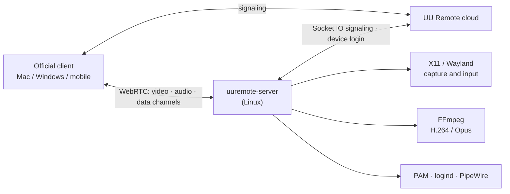

# uu-remote-linux · Unofficial Linux host for NetEase UU Remote

[简体中文](README.md) | **English**

> **A note first**
>
> NetEase UU Remote (网易 UU 远程) is a great remote-desktop tool, but there is no Linux version on its
> official website. So, with the help of Claude and Codex, I wrote this open-source Linux host: install it,
> and you can control your Linux machine from the official Mac / Windows / mobile UU Remote clients.
>
> This is a personal hobby project. **It is not affiliated with NetEase and is not an official client.**
> If NetEase considers this project infringing or inappropriate, please DM me on X
> **[@ai_fengshou](https://x.com/ai_fengshou)** and I will take it down right away.

<p align="center"></p>
<p align="center"><sub>The QR login window shown on first run (QR code blurred). The UI is in Chinese, like the official app.</sub></p>

<!-- Screenshot placeholder: the Linux desktop controlled from the official client. Take your own
     screenshot, remove account/device details and NetEase logos, save it as docs/images/remote-desktop.png
     and uncomment the next line. -->
<!-- <p align="center"></p> -->

## What it is

- A native Linux program written in Rust: no Wine, no Windows or macOS components.
- Log in by scanning a QR code with your own UU Remote account. The Linux machine then appears in the
  official clients' device list and is used just like a Windows host.
- **Host only.** To control other machines you still use the official Mac / Windows / mobile apps.

## Features

| Feature | Notes |
|---|---|
| QR login | GTK login window (or a terminal QR code with `login --no-gui`); expired codes refresh automatically; the service opens the login window by itself when credentials are missing or expired |
| Remote desktop | H.264 video, NVENC hardware encoding on NVIDIA GPUs, libx264 otherwise; the viewer draws its local pointer, so there is no double cursor |
| Mouse / keyboard | Absolute and relative motion, clicks, wheel, keys; no spurious key repeat on high-latency links |
| Pointer shape | Remote cursor shape is mirrored to the viewer (X11) |
| Clipboard | Two-way text sync |
| Quality / frame rate / resolution | Auto, Original 20M, Ultra 8M, HD 2M, custom; 30/60/90/144 fps; "other resolutions" are scaled by the encoder, the host monitor is left untouched |
| Sound | System audio captured from PulseAudio / PipeWire and sent as Opus |
| File transfer | Upload, download (including folders), create folder, rename, delete |
| Terminal | The official "Terminal" tool, PTY sessions, multiple sessions, rename |
| Lock state and auto unlock | Lock state is reported to the viewer; with "auto unlock" enabled in the client, the password is verified with PAM and the session is unlocked |
| Lock after remote session | Stored on the host, so it still applies after reconnecting |
| Mute host while controlled | Host speakers are muted while the viewer still hears the sound; the previous mute state is restored afterwards |
| System actions | Lock, show desktop, task manager (system monitor), reboot, shut down |
| Reconnects | Every tool window has its own connection; they do not disturb each other |

## Supported Linux desktops

| Desktop | Display protocol | Status | Build |
|---|---|---|---|
| GNOME (Ubuntu 24.04) | X11 / Xorg | ✅ In daily use on real hardware; every feature above accepted | default |
| KDE Plasma | X11 | ✅ Tested in a VM | default |
| Xfce | X11 | ✅ Tested in a VM | default |
| Cinnamon / MATE | X11 | ✅ Tested in a VM | default |
| Hyprland | Wayland (native wlroots protocols) | 🧪 Experimental, tested in a VM (some features limited, see below) | `--features wayland` |
| GNOME / KDE Plasma | Wayland (xdg-desktop-portal) | 🧪 Experimental, tested in a VM (some features limited, see below) | `--features wayland,portal` |

Apart from GNOME on X11, these desktops have been tested in virtual machines so far. If something goes wrong on
real hardware, please [open an issue](../../issues) with your distribution, desktop, GPU and the relevant lines from
`journalctl --user -u uuremote-native.service`.

Wayland limits: single screen, fixed resolution. The portal backend does not support clipboard, screen wake or
dynamic resolution yet. On the first connection the desktop asks for "Remote Desktop / Screen Sharing"
permission; the permission is remembered once granted.

## Not implemented / not supported

| Feature | Status |
|---|---|
| Switching between multiple monitors | In progress |
| True color (4:4:4) | Not implemented; not declared in the handshake, so the client does not enable it |
| HDR | Not implemented |
| Super screen / virtual display | Not implemented |
| Privacy screen on the host | Not implemented |
| Microphone (viewer audio played on the host) | Not implemented (needs a virtual sound card) |
| Plugins such as the WoW queue notifier | Not supported; the client is told that no plugins exist |
| Access before login (greeter / no user logged in) | Not supported; only an already logged-in desktop session can be controlled |
| Port mapping | Code exists, not yet accepted |
| Relay connections on restrictive networks | Uses the ICE servers provided by the UU cloud; complex network setups are not thoroughly tested |
| Acting as a viewer (controlling other machines from Linux) | Out of scope |

## Installation

### 1. Dependencies (Ubuntu / Debian)

```sh
sudo apt install build-essential pkg-config \
    libx11-dev libxext-dev libxtst-dev libxfixes-dev \
    libgtk-3-dev ffmpeg
# optional: Wayland backend
sudo apt install libwayland-dev libxkbcommon-dev wl-clipboard
# optional: GNOME/KDE portal backend
sudo apt install libglib2.0-dev libpipewire-0.3-dev
```

- A Rust toolchain is required (<https://rustup.rs>).
- `libgtk-3-dev` is optional. Without GTK, login works with a QR code in the terminal (`UU_NO_GTK=1` disables
  the login window explicitly).
- On NVIDIA GPUs use an FFmpeg build with `h264_nvenc`; otherwise the CPU encoder (libx264) is used.

### 2. Build

```sh
cargo build --release                             # X11
cargo build --release --features wayland          # + Hyprland
cargo build --release --features wayland,portal   # + GNOME/KDE on Wayland
```

### 3. Log in

Run inside your graphical session:

```sh
./target/release/uuremote-server login
```

Scan the code with the **NetEase UU Remote mobile app** and confirm. Credentials are stored only on this
machine, in `~/.config/uuremote/config.json` (mode 0600).

### 4. Run as a user service

`~/.config/systemd/user/uuremote-native.service`:

```ini
[Unit]
Description=UU Remote Linux host (unofficial)
After=graphical-session.target

[Service]
Environment=RUST_LOG=info
# X11 desktops need the display; on GNOME, XAUTHORITY is usually /run/user/<uid>/gdm/Xauthority
Environment=DISPLAY=:0
ExecStart=%h/.local/bin/uuremote-server
Restart=always
RestartSec=5

[Install]
WantedBy=default.target
```

```sh
install -Dm755 target/release/uuremote-server ~/.local/bin/uuremote-server
systemctl --user daemon-reload
systemctl --user enable --now uuremote-native.service
journalctl --user -u uuremote-native.service -f   # online once you see availability=Some("ready")
```

If you have not logged in yet, the service opens the QR login window on your desktop.

## Configuration

Common environment variables:

| Variable | Purpose |
|---|---|
| `UU_CONFIG` | Config file path (default `~/.config/uuremote/config.json`) |
| `UU_DESKTOP_BACKEND` | `auto` / `x11` / `wayland` / `portal` |
| `UU_VIDEO_ENCODER=cpu` | Force CPU encoding |
| `UU_FFMPEG_ROOT` | Use FFmpeg from this prefix |
| `UU_AUDIO=0` | Disable sound; `UU_AUDIO_SOURCE` picks the PulseAudio source |
| `UU_LOGIN_WINDOW=0` | Do not open the login window automatically when credentials are missing |

Host settings such as "lock after remote session" and "mute host" are stored in
`~/.config/uuremote/host_settings.json`.

## Let an AI agent install or develop it

If you use Claude Code, Codex, Cursor or a similar coding agent, have it read [AGENTS.md](AGENTS.md) first.
It is written for language models: build and install steps, a code map, protocol notes and development rules,
enough to take over installation or development.

## How it works



- The host registers with UU Remote as a "Windows PC", so the official clients recognize it directly.
- The screen is encoded to H.264 and the sound to Opus with FFmpeg, both sent over WebRTC; keyboard, mouse,
  clipboard, files and terminal use WebRTC data channels.
- Protocol details were learned by observing the official clients' traffic and analyzing their publicly
  released programs, for interoperability only. This repository contains **no** NetEase programs, logos or assets.

## Security and privacy

- Logs never contain keystrokes, terminal text, clipboard contents, file contents, passwords or tokens.
- For auto unlock the password is stored in the **viewer** (the official client). The host only checks it
  once with PAM; it is never written to disk or logs.
- Only devices logged in to the same UU account can connect. Keep your UU account safe.

## License

Released under the [GPL-3.0](LICENSE): you may use, modify and redistribute it, but redistributed versions
(including modified ones) must also be released under the GPL-3.0.

## Disclaimer

- "NetEase", "网易" and "UU 远程 / UU Remote" are names and trademarks of NetEase, Inc. This project is not
  affiliated with, authorized or endorsed by NetEase.
- It was built for interoperability. Use it in accordance with the UU Remote user agreement and your local
  laws, at your own risk.
- NetEase or other rights holders with concerns: please contact [@ai_fengshou](https://x.com/ai_fengshou)
  on X and I will cooperate or take the project down.

## Acknowledgements

- The NetEase UU Remote team, for a remote tool that is a pleasure to use.
- [webrtc-rs](https://github.com/webrtc-rs/webrtc), FFmpeg, GTK and the other open-source projects this builds on.
- Most of the code was written with the help of Claude and Codex.
