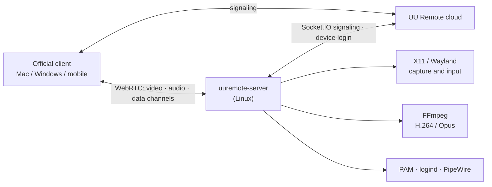

# uu-remote-linux · Unofficial Linux host and viewer for NetEase UU Remote

[简体中文](README.md) | **English**

> **A note first**
>
> NetEase UU Remote (网易 UU 远程) is a great remote-desktop tool, but there is no Linux version on its
> official website. So, with the help of Claude and Codex, I wrote this open-source Linux host: install it,
> and you can control your Linux machine from the official Mac / Windows / mobile UU Remote clients.
> It now also ships an **experimental Linux viewer**, `uuremote-viewer`, that controls official Windows / Mac hosts or this
> project's host from Linux (desktop, file transfer, terminal, port mapping, remote assistance; see
> [below](#experimental-native-viewer-uuremote-viewer)).
> Desktop-less **Synology / NAS** boxes can run it in Docker: [deployment guide](docs/deploy-nas-docker.md#english), image
> [`ghcr.io/vallierdev/uu-remote-linux`](https://github.com/VallierDev/uu-remote-linux/pkgs/container/uu-remote-linux).
>
> This is a personal hobby project. **It is not affiliated with NetEase and is not an official client.**
> If NetEase considers this project infringing or inappropriate, please DM me on X
> **[@ai_fengshou](https://x.com/ai_fengshou)** and I will take it down right away.

<p align="center"></p>
<p align="center"><sub>Linux viewer: device list (device names redacted)</sub></p>

<p align="center"></p>
<p align="center"><sub>Linux host main window: remote assistance and account (device ID, code and account redacted). The UI is available in Chinese and English (see [Language](#language--语言)).</sub></p>

## Language / 语言

The language is picked once at start, in this order:

1. `UU_LANG=en` or `UU_LANG=zh`;
2. the choice saved in the viewer's **Settings → General → 语言 / Language**
   or the host main window's 语言 / Language row; stored as `~/.config/uuremote/language`, applies after a restart);
3. the locale: `LC_ALL` / `LC_MESSAGES` / `LANG` starting with `zh` → Chinese, anything else → English.

```sh
UU_LANG=en uuremote-viewer ui
UU_LANG=zh uuremote-server
```

Protocol strings and messages that come from the UU servers are shown as the server sends them.

<!-- Screenshot placeholder: the Linux desktop controlled from the official client. Take your own
     screenshot, remove account/device details and NetEase logos, save it as docs/images/remote-desktop.png
     and uncomment the next line. -->
<!-- <p align="center"></p> -->

## What it is

- A native Linux program written in Rust: no Wine, no Windows or macOS components.
- Log in by scanning a QR code with your own UU Remote account. The Linux machine then appears in the
  official clients' device list and is used just like a Windows host.
- **Host only.** To control other machines you still use the official Mac / Windows / mobile apps.

## Features

| Feature | Notes |
|---|---|
| Main window and QR login | One window with "This device" (remote assistance) and "Account": a QR code before sign-in, the account and a sign-out button after; `login --no-gui` prints the QR in a terminal |
| Remote assistance (experimental) | Like the official client: share the **device ID + verification code**; the other person enters them under 开始协助 in UU Remote. Works before sign-in (guest identity) and after; see below |
| Remote desktop | H.264 video, NVENC hardware encoding on NVIDIA GPUs, libx264 otherwise; the viewer draws its local pointer, so there is no double cursor |
| Mouse / keyboard | Absolute and relative motion, clicks, wheel, keys; no spurious key repeat on high-latency links; optional uinput virtual devices on Wayland (layout independent, see below) |
| Mac shortcuts | **Recommended**: turn off 「使用 macOS 快捷键」 (use macOS shortcuts) in the Mac viewer's remote-window menu; then Cmd+C/V/A/F/X/Z work as on a Mac (Cmd+C/V become Ctrl+Shift+C/V in terminals) and Ctrl+C always interrupts. With the option on, the viewer sends Cmd as Ctrl: in a terminal Ctrl+V / Cmd+V paste, Ctrl+C interrupts, copy is Cmd+Shift+C (X11) |
| Pointer shape | Remote cursor shape is mirrored to the viewer (X11) |
| Clipboard | Two-way text sync; Wayland mobile IME text inputs use clipboard paste fallback (see below) |
| Quality / frame rate / resolution | Auto, Original 20M, Ultra 8M, HD 2M, custom; 30/60/90/144 fps; on X11 a resolution choice changes the desktop resolution itself like the official Windows host (xrandr, adding the mode when missing; restored for "original" or on disconnect), `UU_DESKTOP_RESIZE=0` scales in the encoder instead; Wayland scales in the encoder |
| Sound | System audio captured from PulseAudio / PipeWire and sent as Opus |
| File transfer | Upload, download (including folders), create folder, rename, delete |
| Terminal | The official "Terminal" tool, PTY sessions, multiple sessions, rename |
| Lock state and auto unlock | Lock state is reported to the viewer; with "auto unlock" enabled in the client, the password is verified with PAM and the session is unlocked |
| Lock after remote session | Stored on the host, so it still applies after reconnecting |
| Mute host while controlled | Host speakers are muted while the viewer still hears the sound; the previous mute state is restored afterwards |
| System actions | Lock, show desktop, task manager (system monitor), reboot, shut down (via `systemctl`; needs polkit permission for the user, usually an active local graphical session; without it the action fails and is logged, no password dialog appears on the host) |
| Port mapping | The official "port mapping" tool: forwards a local port on the viewer to an address reachable from the Linux host (e.g. 127.0.0.1:22); `UU_PORT_MAPPING=0` disables it |
| Reconnects | Every tool window has its own connection; they do not disturb each other |
| Headless servers | Goes online without a monitor with terminal, file transfer and port mapping; an Xvfb virtual desktop gives a full remote desktop (see below) |

Desktop connection boundaries and host startup clear stale input; delayed events
from an old desktop cannot affect its replacement. X11 clears pressed state on
the authenticated display (including physical keys whose origin it cannot
distinguish); uinput clears only this host's virtual devices, and Portal only its
authorized session. Independent file/terminal tool peers do not reset input.

## Supported Linux desktops

| Desktop | Display protocol | Status | Build |
|---|---|---|---|
| GNOME (Ubuntu 24.04) | X11 / Xorg | ✅ In daily use on real hardware; every feature above accepted | default |
| KDE Plasma | X11 | ✅ Tested in a VM | default |
| Xfce | X11 | ✅ Tested in a VM | default |
| Cinnamon / MATE | X11 | ✅ Tested in a VM | default |
| Hyprland | Wayland (native wlroots protocols) | 🧪 Experimental, tested in a VM (some features limited, see below) | `--features wayland` |
| niri | Wayland (native wlroots protocols) | 🧪 Experimental; capture, text input and portrait switching hardware-tested; other features pending (#55) | `--features wayland` |
| GNOME / KDE Plasma | Wayland (xdg-desktop-portal) | 🧪 Experimental; validation scope and limits below | `--features wayland,portal` |

The GNOME Wayland Portal/EIS path has been checked for video and mouse/keyboard input on Ubuntu 26.04, GNOME 50, with one 4K screen at 200% scale; auto unlock after a cold locked connection is verified with the official Mac and iPhone 4.42.0 viewers, while other lock recovery and reconnection still need hardware acceptance testing. Apart from that path and GNOME on X11, desktop testing has primarily used virtual machines. If something goes wrong on
real hardware, please [open an issue](../../issues) with the output of `uuremote-server doctor` (v0.2.17+; session, backend,
plugins, permissions and encoders only, no account data, tokens or addresses) and the relevant lines from
`journalctl --user -u uuremote-native.service`.

Wayland limits: captures one screen by default; Hyprland can enable monitor switching as described below. Resolution is fixed. The native Hyprland backend now pipelines two shm screencopy buffers and passes the viewer's requested fps to both capture pacing and the encoder. Actual fps remains limited by the compositor, rendering and readback (the old serial path measured about 16–22 fps at 2560x1600; the pipeline is VM-measured only, not a hardware guarantee). The portal backend does not support dynamic resolution; see below for GNOME wake and lock recovery; the clipboard syncs while the viewer's remote window has focus. On the first connection the desktop asks for "Remote Desktop / Screen Sharing"
permission; the permission is remembered once granted.

**Touch from mobile viewers (GNOME)**: in touch mode the Android/iOS viewers send a finger as a left-button drag, which on a desktop selects text. The host asks the portal for the touchscreen device type where it is offered and replays those drags from mobile controllers as one finger, so the desktop scrolls and taps as on a touch screen. A consent saved before this change restores keyboard and pointer only: the first drag from a phone then asks the host once more in the background (the GNOME share dialog, which the phone also sees in the picture; it closes after the consent timeout), and an approval for the same monitor switches to touch without reconnecting. The saved consent is never removed beforehand, and the host asks at most once per run. Without a touchscreen grant, drags stay mouse drags. `UU_TOUCH_INPUT=0` keeps mouse drags and never asks.

**Mobile IME typing and clipboard on Wayland**: Mobile IME text (`text_input`) on Wayland is typed through spare keycodes on wlroots compositors. On GNOME (Portal) printable ASCII is typed as keysyms when the active input source is a Latin xkb layout (Mutter picks the key and Shift level); other text, KDE and compositors where keycodes are exhausted fall back to "system clipboard write + `Shift+Insert` (or `UU_WAYLAND_PASTE_KEY=ctrl_v`)". VTE terminals paste the PRIMARY selection on `Shift+Insert`, which is why ASCII is typed instead. **Note**: This fallback replaces the host's existing clipboard contents and may echo back to the viewer's clipboard via two-way sync; set `UU_WAYLAND_TEXT=0` to completely disable Wayland mobile text input and clipboard paste fallback.

Scaled GNOME desktops using native Portal input use EIS on the same authorized session when `ConnectToEIS` and a screen `mapping_id` are available. Each axis is mapped using the matched region and actual frame dimensions, with no fixed resolution or scale factor. This avoids scaled-coordinate rejection by `NotifyPointerMotionAbsolute`. Portal builds require libei >= 1.1. Missing EIS support retains the legacy input path and its existing scaling limitations; other initialization failures are reported and trigger session recovery. After a successful EIS connection, all input uses EIS. Capture alone and uinput do not initialize EIS; missing optional logical dimensions do not block capture. Keyboard input uses the existing Windows VK to evdev mapping. Recovery keeps the encoder frame dimensions fixed but accepts logical-size changes after scaling. On GNOME, a display-change notification enables earlier recovery when previously streaming Portal capture remains paused without a valid format for a 200 ms grace after both conditions are present. Healthy renegotiation cancels the early check; repeated notifications do not postpone the same interruption. The five-second fallback remains without a related notification. Static video and valid-format pauses do not trigger recovery. Tested while connected on Ubuntu 26.04, GNOME Wayland, one 3840x2160 display: 200% -> 166.67% -> 200%, with continuously updating video and full-screen pointer control after recovery. Switching briefly freezes and goes black before recovering; five seconds is the fallback threshold, not total recovery time. See [#35](../../pull/35) for timing measurements and validation limits. Lock recovery still needs hardware acceptance testing; multi-monitor support, live resolution changes, and rotation/reflection transforms are outside this fix's scope. Capture settings remain at protocol version 4: advertised resolutions use pixel coordinates and DPR 1; Portal logical dimensions are used only for local input mapping.

GNOME Portal CONTROL no longer waits for a consent dialog or the first video frame. It announces the selected desktop before reporting secure-desktop state and receiving the official viewer's “auto unlock host” request. The official Android viewer requires this desktop selection before entering its auto-unlock flow, so the notification must precede capture readiness; actual screen dimensions, codec information and capture permissions still follow their real readiness state. Enable auto unlock in the viewer and use the current Linux user's login password. The host verifies it with PAM, unlocks the existing GNOME session, requests display wake, and restores capture, input and clipboard through the shared Portal session. Initial consent or revoked permissions still require local approval. Reconnect if physical or logical dimensions change.

The host also accepts a desktop connection while GNOME is locked with no Portal session yet (a cold connection): it reports lock state and accepts auto unlock, then restores picture, input and clipboard after unlock. While Portal is pending, the host sends generated black video once per second on the negotiated track by default, allowing the official iPhone viewer to enter its auto-unlock flow without extra configuration. Verified on Ubuntu GNOME Wayland with the official Mac viewer; iPhone 4.42.0 with H.265 completed a same-executable control experiment: black video ON succeeded, OFF failed, and ON succeeded again ([#29](../../issues/29)). **Limitation**: this is synthetic black video, not the GNOME lock screen, and it does not enable native mouse/keyboard input while locked. Enable 「自动解锁被控端」 in the UU client under 控制中心 → 安全 and enter the password. Without saved Portal permission, local consent is still required after unlock before the real desktop can appear.

Existing screen-off and lock settings remain unchanged. Only capture recovery in an unlocked session temporarily holds a GNOME idle inhibitor; the first frame, lock, disconnect or initialization failure releases it. An idle viewer still allows the normal screen-off and lock timeout, and manual lock remains effective. Desktop input is blocked and real video is hidden while locked or when lock state is unknown. Independent terminal, file-transfer and port-mapping peers do not wait for video initialization and survive desktop reconnection. Automated protocol and lifecycle regression tests cover this path; auto unlock and capture recovery after a cold locked connection are verified on GNOME hardware with the official Mac and iPhone 4.42.0 viewers, while screen-off and the other scenarios still need acceptance testing. Waking a fully suspended or hibernating machine is outside this CONTROL path.

Locked black video requires FFmpeg's libx264/libx265 encoder for the negotiated H.264/H.265 codec; hardware encoding support alone does not satisfy this dependency. Encoder failures are logged explicitly. Synthetic video does not change capture permissions or advertised monitor dimensions. It pauses on unlock or unknown lock state, ends when capture is ready/rejected or the connection closes, and then hands the same video track to real capture. See [#29](../../issues/29) and [#34](../../pull/34) for the controlled experiment and validation scope.

The native Wayland backend needs `wlr-output-power-management` from the compositor to wake a turned-off screen; without it only wake is unavailable — capture and encoding are unaffected. Display-wake failures at video startup or during streaming are logged and retried at the next interval without ending the video stream; capture, encoder and send errors retain their existing handling.

Native Wayland experiments: `UU_WAYLAND_PIPELINE=0` disables pipelining for comparison.
`UU_WAYLAND_DMABUF=1` explicitly tries dma-buf → GBM CPU mapping (off by default;
requires runtime libgbm; `UU_WAYLAND_DMABUF_DEVICE` overrides `/dev/dri/renderD128`).
Only single-plane 8-bit RGB with an advertised linear modifier is supported;
failure falls back to SHM. The virgl VM verified fallback only: successful import,
mapping and hardware acceleration remain unverified. This is not zero-copy VAAPI;
`UU_VIDEO_ENCODER=vaapi` still uploads CPU frames through FFmpeg.

### Monitor switching (experimental)

Native Wayland absolute pointer motion now targets the captured output by default, fixing multi-monitor click offsets. uinput may still handle keyboard, buttons and relative motion.

Set `UU_WAYLAND_MULTISCREEN=1` to select physical monitors from the phone client. `UU_WAYLAND_OUTPUT` chooses the initial output. Capture and absolute pointer targeting switch together across different resolutions, scales and desktop positions.

X11 sessions send all monitors as one combined picture by default. With `UU_X11_MULTISCREEN=1` the host lists the monitors from `xrandr --listmonitors`; the viewer selects one, only that region is captured, and absolute pointer positions are offset to that monitor. The primary monitor is the default; `UU_X11_OUTPUT` picks another (e.g. `HDMI-1`). The layout is read when the host starts; restart the service after changing it. In this mode the viewer's resolution setting scales the stream instead of changing the display mode. Experimental: unit tests and Xvfb virtual monitors only, not yet accepted with the official clients.

Switching reuses one video track and pauses input until the new source sends a frame. Capture/encoder failure or a first-frame timeout requests restoration of the previous source. The inventory uses `hyprctl` and supports unrotated outputs; restart the host after monitor hotplug or layout changes. Phone-side switching and clicks were tested on Omarchy / Hyprland with 2560×1440 at 125% and 1920×1080 at 133.33%.

On niri, `niri msg --json outputs` enumerates enabled monitors. Normal and 90/180/270-degree capture and pointer transforms are enabled only with `NIRI_SOCKET`; reflected transforms are excluded. Three-output switching, 90-degree portrait capture/click alignment, and mobile Chinese input into Codex were hardware-tested on CachyOS + niri. Other compositors retain their existing text path and reject rotated outputs. Restart after layout changes. The temporary printable-key text keyboard is niri-only; the Hyprland fast path and pristine-keymap restoration are unchanged.

## Not implemented / not supported

| Feature | Status |
|---|---|
| Switching between multiple monitors | Experimental on native niri / Hyprland Wayland and on X11 (`UU_X11_MULTISCREEN=1`); see above |
| True color (4:4:4) | Supported (v0.1.15): the default FFmpeg pipeline with NVENC / libx264 encodes H.264 High 4:4:4; `inproc-av` native NVENC encodes H.264 High 4:4:4 / HEVC FRExt; VAAPI stays 4:2:0 and reports that to the client |
| HDR | Not implemented |
| Super screen / virtual display | Not implemented |
| Privacy screen on the host | Not implemented |
| Microphone (viewer audio played on the host) | Not implemented (needs a virtual sound card) |
| Plugins such as the WoW queue notifier | Not supported; the client is told that no plugins exist |
| Linux login screen | The system login screen (before anyone logs in to the Linux desktop) cannot be controlled yet; use headless mode or a virtual desktop (see below). This is about the Linux login: **without a UU account** the host can now be used through remote assistance |
| Relay connections on restrictive networks | Uses the ICE servers provided by the UU cloud; complex network setups are not thoroughly tested |
| Acting as a viewer (controlling other machines from Linux) | 🧪 Experimental `uuremote-viewer`, see [below](#experimental-native-viewer-uuremote-viewer) |

## Installation

### 0. Prebuilt release package (recommended, x86_64 / aarch64)

**Ubuntu / Debian (v0.2.18+)**: download `uu-remote-linux_<version>_amd64.deb` (ARM64: `arm64`), then:

```sh
sudo apt install ./uu-remote-linux_<version>_amd64.deb
uuremote-server login                                   # scan the QR code with the UU Remote app
systemctl --user enable --now uuremote-native.service   # start with the graphical session
```

The deb installs the binaries, plugins, a systemd user unit and menu entries, and pulls in FFmpeg as a dependency; uinput access stays opt-in (step 5).
GNOME and KDE pass the display environment to the unit; on desktops that don't (e.g. Xfce) add `DISPLAY` as in step 4.

**Other distributions**: download `uu-remote-linux-<version>-x86_64-linux.tar.gz` (ARM64: `aarch64-linux`) from [Releases](../../releases/latest), extract it, then run as your desktop user (not root):

```sh
cd uu-remote-linux-<version>-x86_64-linux
./install.sh          # --yes: don't ask; --no-ffmpeg: check only
```

The script installs the binaries and plugins under `~/.local`, writes the systemd user unit (an existing one is kept) and checks
FFmpeg with libx264 (without it the viewer stays on 正在传输画面). A missing FFmpeg is installed through sudo with apt or pacman;
Fedora needs RPM Fusion and openSUSE needs Packman first, and the script only prints the command instead of adding third-party repositories.
The host also checks FFmpeg at startup and on every desktop connection: when it is not runnable it logs an error and shows a desktop notification (without a notification daemon it opens its window with a red hint), at most every 5 minutes. Install it and reconnect; no restart is needed.

One package covers X11, wlroots compositors (Hyprland, Sway, niri) and GNOME/KDE Wayland: the backend is chosen from the
running session at startup, and the matching `libuu-*.so` is loaded only on Wayland, so X11 hosts need no Wayland libraries.

| Session | Requirements |
|---|---|
| X11 | glibc >= 2.35 (Ubuntu 22.04, Debian 12 and newer) |
| wlroots (Hyprland / Sway / niri) | the same, plus `libwayland-client` and `libxkbcommon` (present on Wayland desktops) |
| GNOME / KDE Wayland | glibc >= 2.39 (Ubuntu 24.04, Fedora 40, Debian 13 and newer), libei >= 1.1 and PipeWire |

Plugins are found next to `uuremote-server`, in `../lib/uu-remote-linux/`, `~/.local/lib/uu-remote-linux/` or
`/usr/lib/uu-remote-linux/` (`UU_ENGINE_DIR` overrides); a missing library or too old glibc is reported in the log.
Continue with step 3 (login). Other architectures: build from source below.

### 1. Dependencies (Ubuntu / Debian)

```sh
sudo apt install build-essential pkg-config \
    libx11-dev libxext-dev libxtst-dev libxfixes-dev \
    libgtk-3-dev ffmpeg
# optional: Wayland backend
sudo apt install libwayland-dev libxkbcommon-dev wl-clipboard
# optional: GNOME/KDE portal backend
sudo apt install libglib2.0-dev libpipewire-0.3-dev libei-dev
# optional: headers for the inproc-av VAAPI/DRI3 engines (libva itself is loaded at runtime)
sudo apt install libva-dev libgbm-dev libx11-xcb-dev libxcb-dri3-dev libxcb-damage0-dev
```

- A Rust toolchain is required (<https://rustup.rs>).
- `libgtk-3-dev` is optional. Without GTK, login works with a QR code in the terminal (`UU_NO_GTK=1` disables
  the login window explicitly).
- On NVIDIA GPUs use an FFmpeg build with `h264_nvenc`; otherwise the CPU encoder (libx264) is used.

### 2. Build

```sh
cargo build --release                             # X11
cargo build --release --features wayland          # + Hyprland
cargo build --release --features wayland,portal   # + GNOME/KDE on Wayland
```

The viewer's `viewer-ffmpeg` feature supports **FFmpeg 6.x only** (`pkg-config --modversion libavcodec` = 60.x); FFmpeg 7+ fails inside `ffmpeg-sys-next` with `avfft.h file not found` (#63).
The host's optional `--features inproc-av` encodes with hardware inside the process on X11. It does not link FFmpeg development libraries; it loads the NVIDIA driver libraries (`libcuda.so.1`, `libnvidia-encode.so.1`) at runtime for NVENC (needs a driver with NVENC API 12.1, 530 or newer) and `libva.so.2`/`libva-drm.so.2` for VAAPI. When the capture and encoder sizes match, NVENC reads the XShm buffer directly, saving one host-to-device copy; VAAPI runs in process under the same feature (DRI3 DMA-BUF zero copy, or XShm upload without DRI3, then VPP to NV12 and VCN; H.264/HEVC). CPU encoding and `UU_CAPTURE=grab` keep the FFmpeg process; if the in-process hardware session fails it falls back to the matching FFmpeg process pipeline, then to the CPU. The default build and the release packages need neither feature.

### 3. Log in

Run inside your graphical session:

```sh
./target/release/uuremote-server login
```

Scan the code with the **NetEase UU Remote mobile app** and confirm. Credentials are stored only on this
machine, in `~/.config/uuremote/config.json` (mode 0600).

A failed status query or the 60-second request timeout does not prove that the QR expired or that the phone confirmed login. The official-client refresh policy is unchanged: after a query error, click Refresh QR (Enter in a terminal; refresh after 60 seconds with neither a window nor a terminal). QR request diagnostics contain only the request phase, error category, elapsed time, HTTP/API status and last known scan state—not tickets, URLs or response content. A `connect` category alone does not identify a DNS, TLS or proxy cause.

The same file holds this machine's device identity (`device_id`, `client_id`, `system_id`), which reinstalls and new QR logins keep. **Do not copy `config.json` between machines or clone a second host from a snapshot/disk that includes the home directory**: two host instances with one identity, on the same or different machines, kick each other out of the room. The log then shows `Cloud room leave without peer identifier` every few seconds with reconnects, and viewers disconnect right after connecting. On a cloned or copied machine, stop the service, remove those three keys plus `token`, `csrf` and `user_id`, and run `uuremote-server login` to register a new device. A leftover instance on the same machine (for example an old `~/.local/bin/uuremote-server` started by hand) has the same effect; `uuremote-server doctor` warns when more than one host instance is running.

### 4. Run as a user service

`~/.config/systemd/user/uuremote-native.service`:

```ini
[Unit]
Description=UU Remote Linux host (unofficial)
After=graphical-session.target
PartOf=graphical-session.target

[Service]
Environment=RUST_LOG=info
# GNOME/KDE import DISPLAY / WAYLAND_DISPLAY into the user manager and start graphical-session.target
ExecStart=%h/.local/bin/uuremote-server
Restart=always
RestartSec=5

[Install]
WantedBy=graphical-session.target
```

```sh
install -Dm755 target/release/uuremote-server ~/.local/bin/uuremote-server
systemctl --user daemon-reload
systemctl --user enable --now uuremote-native.service
journalctl --user -u uuremote-native.service -f   # online once you see availability=Some("ready")
```

If you have not logged in yet, the service opens the QR login window on your desktop.

Desktops that never start `graphical-session.target` (e.g. Xfce, i3) will not autostart this unit: change `[Install]` to
`WantedBy=default.target`, add `Environment=DISPLAY=:0` (your actual display) and `enable` again. Headless mode and the
virtual desktop below also need `default.target`.

### 5. uinput virtual keyboard/mouse on Wayland (recommended)

On Wayland (especially GNOME/KDE via the portal) the default input path needs portal consent and some keyboard layouts
drop symbols such as the underscore. Once the logged-in user may access `/dev/uinput`, the host switches to kernel
virtual devices that send physical key codes:

```sh
echo 'KERNEL=="uinput", SUBSYSTEM=="misc", OPTIONS+="static_node=uinput", TAG+="uaccess"' | \
    sudo tee /etc/udev/rules.d/60-uu-remote-linux-uinput.rules
sudo udevadm control --reload && sudo udevadm trigger --name-match=uinput
```

`uaccess` grants access only to the user sitting at the machine. `UU_INPUT_BACKEND=uinput|native` forces a backend.
X11 keeps XTest by default because it handles held keys correctly on high-latency links.

## Remote assistance and the main window (experimental)

As in the official client, this host shows a **device ID** and a **verification code**; whoever you give them to can
connect from 开始协助 (remote assistance) in UU Remote.

- **Not signed in**: the main window opens at start, offers remote assistance as a guest and shows the sign-in QR code.
  Signing in switches to account mode automatically.
- **Signed in**: the host is in your device list and remote assistance keeps working (same device ID). A background
  service keeps the window hidden; open it with `uuremote-server show` or the "UU Remote Linux Host" launcher.
  Closing the window only hides it.
- **Tray icon**: a background host shows a tray icon with Open main window, the allow switch and Quit. GNOME needs
  the AppIndicator extension (bundled on Ubuntu); Xfce / Cinnamon / KDE work as is. Quit stops `uuremote-native.service`;
  the launcher starts it again.
- **Settings** (as in the official client): allow switch (off by default); verification by temporary code, custom code
  (8–16 letters and digits) or either; temporary code rotation after each session / hourly / 12 h / 24 h / never;
  copy buttons for the ID and the code. Stored in the 0600 config.
- The code is only shown in the local window, never logged. Without a desktop, `uuremote-server assist` shows it on the
  terminal (`allow` / `deny` / `reset` / `mode …` / `refresh …` / `off`).
- **Security**: the ID and code give full control (desktop, files, terminal). Share them only with people you trust.

Optional launcher icon:

```sh
install -Dm644 contrib/desktop/uu-remote-linux.svg ~/.local/share/icons/hicolor/scalable/apps/uu-remote-linux.svg
install -Dm644 contrib/desktop/uu-remote-linux.desktop ~/.local/share/applications/uu-remote-linux.desktop
install -Dm644 contrib/desktop/uu-remote-linux-viewer.desktop ~/.local/share/applications/uu-remote-linux-viewer.desktop
```

Verified with the official Mac viewer: guest connections, wrong-code rejection, code rotation, switching assistance off,
signing in and out. **Remote assistance while signed in has not yet been tested from a different account** (devices of
the same account cannot assist each other, an official restriction).

## Servers without a monitor

**Headless mode** (terminal, file transfer and port mapping only): add `Environment=UU_DESKTOP_BACKEND=none` to the
service, change `[Install]` to `WantedBy=default.target` (`graphical-session.target` never starts without a login), and run `loginctl enable-linger $USER`, so the systemd user manager (with `XDG_RUNTIME_DIR` and the user D-Bus)
starts at boot without a login. The viewer's remote desktop keeps showing "connecting" in this mode; that is expected.
Log in once with `uuremote-server login --no-gui` (QR in the terminal).

**Synology / NAS (Docker)**: run headless mode in a container on a desktop-less NAS (file transfer, terminal, port
mapping): image [`ghcr.io/vallierdev/uu-remote-linux`](https://github.com/VallierDev/uu-remote-linux/pkgs/container/uu-remote-linux),
see the [NAS deployment guide](docs/deploy-nas-docker.md#english). Verified on Synology DSM 7.3 (x86_64).

**Paste files from a Mac terminal**: when using Ghostty over UU's SSH port mapping,
the optional [Mac SSH paste companion](contrib/macos-ssh/README.md) uploads files
copied in Finder before inserting their remote paths. Text and mouse reports pass
through. Ghostty's title and progress bar show upload progress, transferred size,
speed and elapsed time. It does not change the official UU terminal; folders, drag-and-drop and
raw screenshot clipboard data are not supported.

**Virtual desktop**: for a full remote desktop, run a desktop session (Xfce recommended) on an Xvfb screen:

```sh
sudo apt install xvfb xauth x11-utils dbus-x11 dbus-user-session xfce4      # or another session, chosen with UU_VIRTUAL_SESSION
install -Dm755 contrib/virtual-desktop/uu-virtual-desktop ~/.local/bin/uu-virtual-desktop
install -Dm644 contrib/virtual-desktop/uu-virtual-desktop.service ~/.config/systemd/user/uu-virtual-desktop.service
install -Dm644 contrib/virtual-desktop/virtual-display.conf ~/.config/systemd/user/uuremote-native.service.d/virtual-display.conf
loginctl enable-linger $USER
systemctl --user daemon-reload && systemctl --user enable --now uu-virtual-desktop.service
systemctl --user restart uuremote-native.service
```

The virtual screen is `:99`, 1920x1080 by default. Xvfb has no GPU acceleration, so it is a little less smooth than a
real display; NVENC is still used for encoding when an NVIDIA GPU is present. The script exports `DISPLAY` to the
systemd user session so D-Bus-activated programs open on the virtual screen; on a machine that also runs a real desktop
session set `UU_VIRTUAL_BUS=private` so the real session is not affected.

To make a GPU drive a real (non-Xvfb) desktop without a monitor, use a dummy HDMI plug or load an EDID file with the
kernel parameter `drm.edid_firmware=`, then install as for a normal X11 desktop.

## Configuration

Common environment variables:

| Variable | Purpose |
|---|---|
| `UU_CONFIG` | Config file path (default `~/.config/uuremote/config.json`) |
| `UU_DESKTOP_BACKEND` | `auto` / `x11` / `wayland` / `portal` / `kms` (experimental feature) / `none` (headless) |
| `UU_DESKTOP_RESIZE=0` | on X11, keep the desktop resolution and only scale the encoded stream when the viewer picks a resolution |
| `UU_NVENC_RGB=0` / `=1` | NVENC encodes BGRA directly (saves CPU). Off by default when a monitor is connected to the NVIDIA card (slower when the desktop is composited on the same GPU); `0` forces off, `1` forces on |
| `UU_WAYLAND_MULTISCREEN=1` | Enable Hyprland physical monitor switching (off by default) |
| `UU_WAYLAND_OUTPUT` | Initial native Wayland output name, e.g. `HDMI-A-1` |
| `UU_X11_MULTISCREEN=1` | Select and capture X11 monitors separately (experimental, off by default, needs `xrandr`) |
| `UU_X11_OUTPUT` | Initial X11 monitor name (`xrandr --listmonitors`); default: the primary |
| `UU_WAYLAND_NO_VIRTUAL_KEYBOARD=1` | Native Wayland skips the virtual keyboard (e.g. Denial reserves it for its input method); keys go through uinput. Without wlr-virtual-pointer the pointer also uses uinput (#72) |
| `UU_INPUT_BACKEND` | `auto` (default: uinput on Wayland when accessible) / `uinput` / `native` |
| `UU_TERMINAL_SHORTCUTS=0` | Disable the Ctrl+V paste rewrite in terminal windows |
| `UU_VIDEO_ENCODER` | `cpu`: libx264; `vaapi`: opt-in Intel/AMD; `nvenc`: force NVENC; unset or `auto`: a background probe (one synthetic IDR per candidate, 3 s each). With an NVIDIA driver the order is NVENC then CPU; without one the only candidate is CPU and the probe is skipped. A session that starts before the probe finishes uses the previous rule (NVENC if NVIDIA is present, else CPU). On a self-built `--features inproc-av` binary, a process-only failure of NVENC when the in-process engine would try it first on X11 is logged `native_unprobed` and keeps the previous NVENC choice (Wayland, portal, and KMS fall back to CPU). The skipped CPU-only probe is logged `not probed (only candidate)`. A successful probe and that CPU-only skip stay cached while NVIDIA presence matches the report. A later desktop connection whose presence differs starts one background re-probe and still uses the cached encoder until the new result is stored. A hardware-candidate failure (NVENC failed, CPU chosen) is kept for 10 minutes; the next desktop connection after that starts the same re-probe and still uses the cached encoder until the new result is stored. Explicit `cpu` / `vaapi` / `nvenc` does not start the probe. Another failure restarts the 10 minutes. `native_unprobed` is not a temporary failure. A non-`auto` `video_encoder` in `host_settings.json` wins. VAAPI stays out of auto until #33 |
| `UU_VAAPI_BUFFER_MS` | VAAPI VBV buffer in ms (10-1000, VAAPI only); raise it when keyframes are squeezed into a blur at high resolution |
| `UU_NVENC_BUFFER_MS` | NVENC VBV buffer in ms (10-1000, NVENC only, including the in-process engine); the default is 100-500 kbit, set `1000` when high-resolution keyframes blur and flicker once per GOP (#103) |
| `UU_FFMPEG_ROOT` | Use FFmpeg from this prefix |
| `UU_AUDIO=0` | Disable sound; `UU_AUDIO_SOURCE` picks the PulseAudio source |
| `UU_REMOTE_ASSIST=0` | Disable remote assistance (no guest assistance before sign-in either) |
| `UU_ASSIST_ALLOW=1` | Allow remote assistance at start (overrides the saved switch) |
| `UU_LOGIN_WINDOW=0` | Do not open the login window automatically when credentials are missing |
| `UU_PORT_MAPPING=0` | Disable port mapping (the official host's controlled-side switch) |
| `UU_WOL_HELPER=1` | Experimental: act as a remote-boot helper like the official Windows host — report this host's LAN info after sign-in and send a magic packet to the LAN when the cloud asks to wake a PC (not verified end to end) |
| `UU_USE_PROXY=1` | Share environment HTTP/HTTPS proxy policy between REST and host/viewer WebSocket signaling; proxies are ignored by default |


`UU_USE_PROXY=1` uses only proxy settings already available to the current process. `HTTP_PROXY` / `HTTPS_PROXY` / `ALL_PROXY` (and lowercase forms) and `NO_PROXY` follow reqwest's standard selection, with uppercase taking precedence. Signaling rejects invalid/unsupported values in the selected variables (HTTP/HTTPS only, not SOCKS), proxy URLs with paths/queries/fragments, and CGI environments that would ignore proxies; this validation is intentionally stricter than silently ignoring bad values. No matching proxy or a `NO_PROXY` match still means direct access; a selected proxy failing does not trigger direct fallback. Certificate verification remains enabled and redirects are not followed, so room authentication is not forwarded to a redirect target.

With it the host also reaches the cloud TURN relays over TCP/TLS (CONNECT through the unauthenticated `http://` proxy in `HTTPS_PROXY`/`ALL_PROXY`, or directly without one), for hosts whose UDP cannot reach the TURN servers but whose TCP/proxy can. TURN certificates are chain-verified; a name mismatch is tolerated only when the cloud-supplied TURN address is an IP (media itself is end-to-end DTLS-SRTP). Without the setting only UDP relays are used, as before. **This creates no new network access**: login, signaling and media each still need an allowed network path. Connector errors expose only fixed categories/HTTP status; do not enable dependency TRACE logs that may record URLs or authentication information.

Host settings such as "lock after remote session" and "mute host" are stored in
`~/.config/uuremote/host_settings.json`. The same file stores `video_encoder`
(`auto`/`cpu`/`vaapi`/`nvenc`) and `video_codec` (`auto`/`h264`/`h265`), written by
`uuremote-server set-encoder` and `uuremote-server set-codec` (illegal arguments exit 2).
A value other than `auto` beats `UU_VIDEO_ENCODER` / `UU_VIDEO_CODEC`; `auto` or a missing
field falls through to the environment, then to auto (NVENC then CPU when an NVIDIA driver
is loaded; CPU with no probe when it is not; codec stays H.265 on hardware and H.264 on CPU).
The probe runs in the background at startup and does not delay the first picture. A success
stays cached until the process exits, except when NVIDIA presence (`/proc/driver/nvidia/version`
or `/dev/nvidia0`) no longer matches the report: the next desktop connection then starts one
background re-probe (`warm_auto_probe`) and still uses the cached encoder until the new result
is stored. An NVENC failure is kept for 10 minutes, and the next desktop connection after that
starts the same background re-probe while still using the cached encoder. `set-encoder` and
`set-codec` both send `SIGUSR2` to the host in `host.pid` when that process is this program.
An encoder change switches each live desktop stream without disconnecting and keeps the codec
negotiated for that session. A failed start follows the existing fallback (in-process, then the
FFmpeg process, then CPU). After a hand edit, `kill -USR2 $(cat ~/.config/uuremote/host.pid)`
does the same. `SIGUSR2` does not re-probe. A codec change takes effect the next time a desktop
connection starts; the running host only logs it. Explicit `vaapi` with 真彩 stays on VAAPI,
encodes 4:2:0, and reports chroma 4:2:0 in CaptureSettingSync field 3. If the chosen encoder
cannot start, the stream falls back to CPU and logs a warning. VAAPI is not an auto candidate
until #33.

Custom bitrate follows the Mbps value selected in the client; for example, 1 Mbps sets an encoder cap of 1000 kbit/s.

With external FFmpeg CPU encoding, the bitrate presets (Original / Ultra / HD / custom) use average bitrate (ABR) to avoid gray keyframes at 4K and low bitrates; Auto keeps constant rate factor (CRF).

## Let an AI agent install or develop it

If you use Claude Code, Codex, Cursor or a similar coding agent, have it read [AGENTS.md](AGENTS.md) first.
It is written for language models: build and install steps, a code map, protocol notes and development rules,
enough to take over installation or development.

For local encoding diagnostics, `desktop-video-probe [output.h264]` accepts `UU_PROBE_FPS`, `UU_PROBE_FRAMES` (default 5), and `UU_PROBE_QUALITY` (1–5); set `UU_PROBE_INPUT=clip.y4m` (also `.mp4` or `frames/%05d.png`) to bypass desktop capture and measure fixed input with the same production FFmpeg encoding options, printing dimensions and encoding statistics, and optionally `UU_PROBE_LOOP=1` to repeat until the requested frame count (unreadable or short input exits nonzero; fixed input always uses the external FFmpeg pipeline).

## How it works



- The host registers with UU Remote as a "Windows PC", so the official clients recognize it directly.
- The screen is encoded to H.264 and the sound to Opus with FFmpeg, both sent over WebRTC; keyboard, mouse,
  clipboard, files and terminal use WebRTC data channels.
- Protocol details were learned by observing the official clients' traffic and analyzing their publicly
  released programs, for interoperability only. This repository contains **no** NetEase programs, logos or assets.

## Security and privacy

- Logs never contain keystrokes, terminal text, clipboard contents, file contents, passwords or tokens.
- For auto unlock the password is stored in the **viewer** (the official client). The host only checks it
  once with PAM; it is never written to disk or logs.
- Only devices logged in to the same UU account can connect. Keep your UU account safe.

## License

Released under the [GPL-3.0](LICENSE): you may use, modify and redistribute it, but redistributed versions
(including modified ones) must also be released under the GPL-3.0.

## Disclaimer

- "NetEase", "网易" and "UU 远程 / UU Remote" are names and trademarks of NetEase, Inc. This project is not
  affiliated with, authorized or endorsed by NetEase.
- It was built for interoperability. Use it in accordance with the UU Remote user agreement and your local
  laws, at your own risk.
- NetEase or other rights holders with concerns: please contact [@ai_fengshou](https://x.com/ai_fengshou)
  on X and I will cooperate or take the project down.

## Acknowledgements

- The NetEase UU Remote team, for a remote tool that is a pleasure to use.
- [webrtc-rs](https://github.com/webrtc-rs/webrtc), FFmpeg, GTK and the other open-source projects this builds on.
- Most of the code was written with the help of Claude and Codex.

### H.265 / HEVC

When both sides support H.265 and the host has a hardware encoder (NVENC / explicit VAAPI), the host uses it (as the official host does: the host picks the codec from both
capability lists; the official Mac viewer lists H265 first in its SDP). The first desktop connection probes a
synthetic frame and announces encoder support with CodecNegotiation. `hevc_nvenc`, `libx265` and explicit
`UU_VIDEO_ENCODER=vaapi` (`hevc_vaapi`); hardware failure falls back to software HEVC, then to H.264.
`UU_VIDEO_CODEC=h264` forces H.264. 8-bit; true color 4:4:4 uses hevc_nvenc `rext` / libx265 `main444-8`.
Verified with the official Mac viewer on an RTX 3090 (hevc_nvenc, including 4:4:4) and with the official Android
viewer on Intel Alder Lake-P (iHD): 2560x1440 fully hardware-encoded, 58 fps decoded at about 10 ms. libx265 is
still not verified against a real viewer.
With CPU-only encoding the default is H.264: libx265 is about ten times slower than libx264 (measured ~15 vs ~155 fps
at 1080p on a 4-core ARM host, #59); `UU_VIDEO_CODEC=h265` forces H.265. The applied frame rate comes from the viewer's
quality/fps menu; `UU_DISPLAY_FPS` only changes the reported display refresh rate.

HEVC access units are split on RFC 7798 picture boundaries instead of AUDs: `hevc_vaapi` with `-aud 1` writes an
AUD only at IRAPs and drops every other picture from the bitstream, so an AUD-based reader turns a whole GOP into
one "frame" and the IRAP gate then rejects all of them: the connection stalls at "transferring" while the host
sends about 12 kbit/s. `UU_VIDEO_CODEC=h265` selects H.265 explicitly for A/B diagnosis.

### VAAPI

`UU_VIDEO_ENCODER=vaapi` or `set-encoder vaapi` selects Intel/AMD H.264 VAAPI explicitly.
`UU_VAAPI_DEVICE` defaults to `/dev/dri/renderD128` (render-node permissions required).
`auto` is NVENC then CPU when an NVIDIA driver is present, and CPU otherwise. VAAPI is
selected only explicitly; putting it in auto waits on #33.
The FFmpeg process uploads NV12 frames to a VAAPI frame pool; a self-built `--features inproc-av`
binary instead runs VAAPI in process on X11 (a DRI3 DMA-BUF of the root window zero-copy, or XShm
upload without DRI3, then VPP to NV12 and VCN; H.264/HEVC).
VBR uses the viewer bitrate preset and CQ-derived minimum QP, no B-frames, async depth 1,
AUD and the existing GOP/VFR timing. Unsupported device/driver/initialization falls back to libx264
with a warning. Accepted on Intel UHD 770 (iHD) with the default FFmpeg process pipeline and the official Mac
viewer (presets, fps, scaling, reconnect; no fallback, ~40% less CPU than libx264 — a figure from the
FFmpeg-process-pipeline era). AMD iGPUs are verified on
the **in-process engine** (`--features inproc-av`): end-to-end sessions with the official Mac viewer passed
acceptance on HawkPoint (Mesa 26.2.3) and Cezanne (Mesa 26.2.5) — HEVC, presets, fps, scaling; on Cezanne,
H.264 and both capture paths were additionally probe-verified: the XShm upload (decodable bitstream, correct
picture) and the DRI3 zero-copy import. Measured on one machine (1920x1200@60, Cezanne iGPU + RTX 3050 Ti):
in-process VAAPI costs about **1/12** of the per-frame encode CPU of libx264 (FFmpeg pipeline, superfast)
and about **1/5** of in-process NVENC. The FFmpeg process pipeline (what the release packages use) is not
separately verified on AMD.

The default VAAPI VBV buffer (100-500 kbit) squeezes keyframes hard at high resolution: on a 2560x1440
H.264 VAAPI stream capped at 30 Mbit/s the first IDR measured 59,910 bytes and the picture blurred at
every GOP before sharpening back. `UU_VAAPI_BUFFER_MS=250` (buffer = bitrate cap x ms/1000) restored that
first IDR to 142,397 bytes and raised the worst-frame Y-SSIM from 0.9492 to 0.9933 without raising the
average bitrate. Off by default; unset or out of the 10-1000 ms range keeps the old buffer. Larger
keyframes can queue briefly on a weak link, so start at 250 ms.

### Virtual audio / 虚拟声卡

The viewer's 静音运行 switch creates the null sink `uu-remote-sink`,
moves streams from the original default output and captures `uu-remote-sink.monitor`.
New output goes to this sink; streams explicitly pinned to other outputs are untouched.
The last desktop session restores the previous default output and unloads the module.
`mute_permanent` retains the physical mute policy, but still releases the virtual sink.
A private recovery record beside the config and a process lock recover crash leftovers on startup.
`pactl` is used when installed (PulseAudio / PipeWire-pulse); plain PipeWire systems without it (default
Ubuntu desktop) use `pw-cli`/`wpctl` for the same sink and WirePlumber moves playing streams. Accepted on
Ubuntu 24.04 with the official Mac viewer. When routing is unavailable, the existing mute/monitor path remains.
Changing the switch restarts only the scoped audio encoder; normal non-muted capture is unchanged.
`virtual-audio-probe` temporarily routes output for five seconds and restores it (local diagnostic).

### Virtual desktop user bus

The supervisor imports DISPLAY and XAUTHORITY into the linger user bus, waits for authenticated
X11 readiness, and keeps its cleanup trap alive. The sample drop-in uses `%t/uu-virtual-99.Xauthority`.
Use a dedicated headless account. See the [setup and official Mac acceptance checklist](contrib/virtual-desktop/ACCEPTANCE.md).

### Arch Linux / Omarchy

```sh
sudo pacman -S --needed base-devel rust pkgconf clang ffmpeg libx11 libxext libxtst libxfixes gtk3 \
  wayland libxkbcommon wl-clipboard libpipewire glib2 libpulse
cargo test --locked --features wayland
cargo build --release --features wayland
```

Omarchy uses Hyprland: run in its user session, select `UU_DESKTOP_BACKEND=wayland`,
and retain `WAYLAND_DISPLAY` / `XDG_RUNTIME_DIR`. This requires wlr-screencopy and the
virtual input protocols supported by Hyprland; other compositors may need `--features wayland,portal`.
For uinput, load `uinput` (at boot: `echo uinput | sudo tee /etc/modules-load.d/uinput.conf`) and apply the uaccess rule above; seat ACLs require an active login.
For unattended accounts, explicitly restrict `/dev/uinput` access to a dedicated group, e.g. `z /dev/uinput 0660 root uinput`
in `/etc/tmpfiles.d/uinput.conf` plus `sudo usermod -aG uinput <user>` (dedicated account only).
This permission can inject into the whole seat, including lock/greeter screens.
`UU_INPUT_BACKEND=uinput` requests kernel devices; verify startup actually reports uinput.
In Hyprland / uwsm sessions `default.target` may start before the compositor exports `WAYLAND_DISPLAY`;
tie the unit to the graphical session instead (community-verified autostart on Omarchy):
`After=` and `PartOf=graphical-session.target`, `ConditionEnvironment=WAYLAND_DISPLAY`,
`Environment=UU_DESKTOP_BACKEND=wayland` (no `DISPLAY`), and `WantedBy=graphical-session.target`.
Keep the unit name `uuremote-native.service` (not a template `uuremote-native@.service`): the desktop icon and
`uuremote-server show` always start that name (override with `UU_SERVICE_UNIT`). `niri --session` also imports
`WAYLAND_DISPLAY` before it is ready, so the same unit applies to niri (#55).
Optional VAAPI: `intel-media-driver` (modern Intel) or `libva-mesa-driver` (AMD), `libva-utils`
for `vainfo`. Optional KMS: `libdrm`. Virtual Xfce: `xorg-server-xvfb xorg-xauth xorg-xdpyinfo
xfce4-session xfce4-panel xfdesktop xfwm4 gnome-terminal`.
If building `viewer-ffmpeg`, rolling Arch FFmpeg may be newer than supported 6.x; use a separate FFmpeg 6 prefix rather than downgrading system FFmpeg (`inproc-av` native NVENC on the host does not depend on FFmpeg).
User-bus headless setup and the official Mac checklist: [virtual desktop acceptance](contrib/virtual-desktop/ACCEPTANCE.md).

### Experimental KMS / 实验后端

`--features kms` plus explicit `UU_DESKTOP_BACKEND=kms` enables a limited linear-framebuffer
prototype; `UU_KMS_DEVICE=/dev/dri/card0`. Requires libdrm headers and deliberately granted
`cap_sys_admin+ep`, plus card-node access. It is never automatically selected or granted privileges.
This capability is broad: it applies to the whole network-facing process and can expose greeter/lock screens that portal consent would hide. Use it only on a disposable machine with a reviewed binary; inspect with `getcap`, revoke with `sudo setcap -r <path>`. A VM greeter capture was solid black, so lock/greeter screens are not supported.
The VM GDM greeter capture was solid black (failed visual acceptance); lock/greeter support and Intel/AMD hardware remain unverified. Use uinput for input; clipboard
is unavailable without a desktop session. No default release behavior changes.
No official "no desktop" error code was found for headless desktop offers, so the existing offer behavior is retained.

## Experimental native viewer (uuremote-viewer)

`uuremote-viewer` is a Linux **viewer/controller**: it connects to and controls other devices on your UU account (official Windows / Mac
hosts or this project's Linux host), and can start remote assistance with someone's device ID and code. It is experimental and
separate from the host `uuremote-server`; the default host build and behaviour are unchanged.

**Get it**: release tarballs include `uuremote-viewer` (x86_64) from this version on. Runtime needs GTK3, SDL2 (Ubuntu/Debian:
`libsdl2-2.0-0`) and the `ffmpeg` command; SDL desktop windows synchronize text clipboard directly on Wayland/X11 without extra clipboard tools; the terminal needs a local
terminal emulator (`TERMINAL` selects one). From source: `sudo apt install libsdl2-dev`, then
`cargo build --release --locked --features native-viewer,viewer-sdl --bin uuremote-viewer`.

SDL clipboard access reuses the desktop window to avoid temporary-window Dock churn on GNOME Wayland (#37).
Synchronization runs only while that window is focused and keeps the 30 KiB text limit. Selections without a supported
text format are skipped; empty-text detection depends on the SDL2 backend. Builds without SDL retain the command backend.
SDL2 reads selections synchronously, so a slow selection owner can temporarily block the window; the bridge timeout cannot interrupt it.
GNOME-to-official-Mac bidirectional clipboard synchronization is still unverified; this change does not resolve host compatibility.

**Use**:
- `uuremote-viewer login`: QR login (reuses the sibling `uuremote-server` login window; `--no-gui` prints a terminal QR). The viewer
  shares `~/.config/uuremote/config.json` with the host (`UU_CONFIG` selects another), so it **cannot connect to a host on the same
  machine with the same identity**; other devices are fine.
- `uuremote-viewer ui`: launcher listing your devices: desktop, view-only, files, terminal, port mapping, reboot/shutdown, assistance.
- CLI: `connect DEVICE false - echo legacy [--view-only]` (desktop), `files DEVICE ls|get|put …`, `terminal DEVICE [SESSION]`,
  `terminal-ui DEVICE NAME`, `portmap DEVICE LOCAL_PORT HOST PORT` (listens on 127.0.0.1 only), `power DEVICE reboot|shutdown`, `unbind DEVICE` (remove a device from the account; also under "More tools" in the launcher),
  `assist CONNECT_ID` (the code is read from one stdin line, never an argument). See `uuremote-viewer --help`.
- **Secure `type` input** (inject keystrokes into an open desktop session — lock-screen PIN/password; never put secrets on argv):
  ```sh
  # Preferred: open desktop via ui/connect first, then type (reuses the session; does not kick the live view)
  UU_INPUT_ENV=UU_SECRET UU_SECRET='…' \
    uuremote-viewer type DEVICE [--delay-ms 40] [--omit-last 1] [--snapshot /path/out.png]
  # Or: printf '%s' '…' | uuremote-viewer type DEVICE
  # Validate only, no network: uuremote-viewer type DEVICE --dry-run
  # If no desktop viewer is running you must pass --new-session (opens a new peer and replaces any already-open desktop window; upstream #30)
  ```
  Brace tokens: `{Enter}` `{Tab}` `{Esc}` `{Backspace}` `{Ctrl+Alt+Del}` …; `{{` is a literal `{`.
  **Layout**: characters are mapped for **US QWERTY** only (non-US layouts may mistype symbols/letters).
  **Windows numeric PIN**: Windows often submits automatically once enough digits are entered — usually no `{Enter}` needed. Use `--omit-last N` to omit the last N characters when you want to fill without signing in.
  Logs and `--dry-run` report lengths/event counts only. When reusing a session, about one second after sending, a PNG frame is saved (default under `$XDG_RUNTIME_DIR/uu-viewer-type/`, mode 0600); the path is logged and printed as `snapshot=…`.
- Ctrl+Alt+F in the desktop window opens the files window on the same connection. `UU_VIEWER_AUDIO=0` disables sound,
  `UU_VIEWER_CLIPBOARD=0` the clipboard, `UU_VIEWER_VIEW_ONLY=1` input; `UU_VIEWER_FFMPEG` selects the ffmpeg binary.
- Desktop offers H.264 / H.265; the host chooses the codec. `UU_VIEWER_CODEC=h264` limits both SDP and decoder capabilities to H.264.
  The default request stays 4:2:0; `UU_VIEWER_CHROMA=444` requests true color (4:4:4) after CONTROL opens. The host may fall back to
  4:2:0, as reported by CaptureSettingSync. FFmpeg converts either chroma format to RGB24 for display.
- Frames are decoded at the host's native resolution and scaled to the window with linear filtering; a host resolution
  change restarts the decoder. `UU_VIEWER_SIZE=WxH` forces a fixed letterboxed canvas instead.

Mac targets use native macOS keycodes; Windows / Linux targets retain Windows VK. Keys follow physical positions, without
automatically translating Ctrl to Command; on a Mac target the PC Super / Windows key acts as Command. Only verified target
platform values 1 (Windows / this project's Linux host) and 4 (Mac) are accepted; unknown values fail explicitly. Account
connections look up the selected device only when the platform is absent; assistance requires it in the join response.
View-only sessions skip this lookup. Media keys and some JIS-specific keys are not mapped; Mac platform detection for remote
assistance and ISO / JIS keyboards have not been tested live.

**Tested live** (author's setup, not full acceptance):
| Feature | Official Windows host | Official Mac host | This project's Linux host |
|---|---|---|---|
| Desktop video (H.264) | ✅ | ✅ | ✅ |
| H.265, 4:4:4 true color | — | — | ✅ (VM, libx265) |
| Keyboard, mouse | ✅ | — | ✅ |
| File list / download / upload | ✅ | — | ✅ |
| Port mapping, terminal | ✅ (PowerShell terminal) | — | ✅ |
| Clipboard (text) | host → viewer only; viewer → Windows not applied yet | — | ✅ both ways (VM) |
| Sound | unconfirmed (no audio packets while the host is silent) | — | ✅ (VM) |
| Remote assistance (ID + code) | — | — | ✅ (VM, guest host) |
| Terminal session list (create, double-click reattach, end) | — | — | ✅ (VM) |
| Reboot, shutdown | — | — | ✅ (VM) |
| Wayland desktop window and clipboard | — | — | ✅ Hyprland, KDE; GNOME window works; clipboard switched to SDL in v0.2.3 (#37, final revision not re-verified live) |

"—" = not tested yet. Only use reboot/shutdown on machines you can restart. **Not tested live**: H.265 / 4:4:4 with official hosts, multiple monitors. Logs carry field
numbers, sizes and states only, never keystrokes, clipboard or file contents, codes or credentials.
