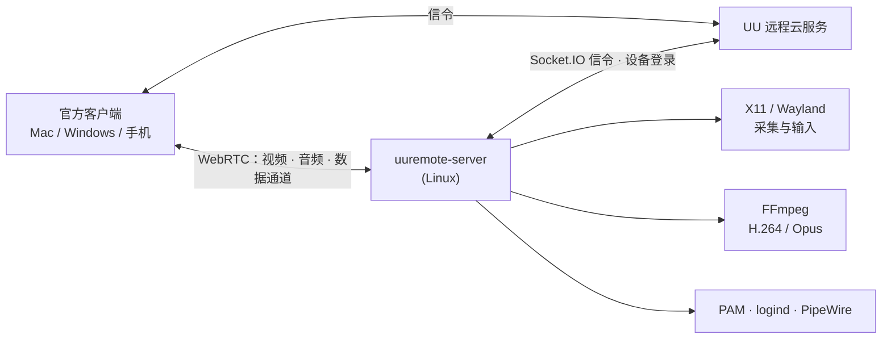

# uu-remote-linux · UU 远程 Linux 被控端（非官方）

**简体中文** | [English](README.en.md)

> **写在前面**
>
> 网易 UU 远程非常好用，但官网一直没有 Linux 版本。于是我借助 Claude 和 Codex，写了这个开源的 Linux 被控端：
> 装上之后，就能用官方的 Mac / Windows / 手机客户端远程控制你的 Linux 电脑。
>
> 这是个人兴趣项目，**与网易无关，也不是官方客户端**。如果网易认为本项目侵权或有不妥，
> 请在推特私信我 **[@ai_fengshou](https://x.com/ai_fengshou)**，我会第一时间自行下架。

<p align="center"></p>
<p align="center"><sub>首次运行时弹出的扫码登录窗口（二维码已打码）</sub></p>

<!-- 截图占位：在官方客户端里远控 Linux 桌面的效果图。请自行截图并去掉账号、设备名等信息后放到
     docs/images/remote-desktop.png，再取消下面这行的注释。注意不要截入网易的图标和品牌素材。 -->
<!-- <p align="center"></p> -->

## 它是什么

- 一个纯 Rust 写的 Linux 原生程序（不需要 Wine，也不需要任何 Windows/macOS 组件）。
- 用你自己的 UU 远程账号扫码登录后，这台 Linux 会出现在官方客户端的设备列表里，用法和 Windows 被控端一样。
- 只做**被控端**：用来控制别人的客户端，仍然是官方的 Mac / Windows / 手机 App。

## 已实现的功能

| 功能 | 说明 |
|---|---|
| 扫码登录 | GTK 登录窗口（或 `login --no-gui` 终端二维码）；二维码过期自动刷新；登录凭证失效时服务会自动弹出登录窗口 |
| 远程桌面 | H.264 视频，NVIDIA 显卡用 NVENC 硬件编码，否则用 libx264；查看端绘制本地鼠标，不会出现双光标 |
| 鼠标 / 键盘 | 绝对/相对移动、点击、滚轮、按键；修复了网络延迟导致的按键连发 |
| 鼠标指针样式 | 远端指针形状实时同步（X11） |
| 剪贴板 | 双向文本同步 |
| 画质 / 帧率 / 分辨率 | 自动、原画 20M、超清 8M、高清 2M、自定义；30/60/90/144 帧；「其他分辨率」由编码器缩放，不改动主机显示器 |
| 声音 | 采集系统声音（PulseAudio / PipeWire），Opus 编码传到控制端 |
| 文件传输 | 上传、下载（含文件夹）、新建文件夹、重命名、删除 |
| 终端 | 官方「终端」工具，PTY 会话，支持多会话和重命名 |
| 锁屏与自动解锁 | 向控制端上报锁屏状态；开启「自动解锁被控端」后，通过 PAM 校验密码并解锁当前会话 |
| 远程结束后自动锁屏 | 设置保存在本机，重连后依然生效 |
| 被控端静音运行 | 主机扬声器静音，控制端照常能听到声音；结束后恢复原来的音量设置 |
| 系统操作 | 锁屏、显示桌面、任务管理器（系统监视器）、重启、关机 |
| 多次重连 | 每个工具窗口独立连接，互不影响 |

## 支持的 Linux 桌面

| 桌面环境 | 显示协议 | 状态 | 编译方式 |
|---|---|---|---|
| GNOME（Ubuntu 24.04） | X11 / Xorg | ✅ 实机长期使用，以上功能全部验收 | 默认 |
| KDE Plasma | X11 | ✅ 虚拟机测试通过 | 默认 |
| Xfce | X11 | ✅ 虚拟机测试通过 | 默认 |
| Cinnamon / MATE | X11 | ✅ 虚拟机测试通过 | 默认 |
| Hyprland | Wayland（wlroots 原生协议） | 🧪 实验性，虚拟机测试（部分功能受限，见下） | `--features wayland` |
| GNOME / KDE Plasma | Wayland（xdg-desktop-portal） | 🧪 实验性，虚拟机测试（部分功能受限，见下） | `--features wayland,portal` |

除 GNOME（X11）外，其余桌面目前都是在虚拟机里测试的。如果你在真机上遇到问题，欢迎[提交 issue](../../issues)，
请附上发行版、桌面环境、显卡型号和 `journalctl --user -u uuremote-native.service` 里的相关日志。

Wayland 下的限制：只支持单屏、固定分辨率；portal 后端暂不支持剪贴板、唤醒屏幕和动态分辨率。
首次连接时，桌面会弹窗请求「远程桌面 / 屏幕共享」授权，同意后会记住授权。

## 尚未实现 / 不支持

| 功能 | 状态 |
|---|---|
| 多显示器切换 | 开发中 |
| 真彩（4:4:4） | 未实现，握手时不声明，客户端不会启用 |
| HDR | 未实现 |
| 超级屏 / 虚拟显示器 | 未实现 |
| 被控端防窥模式 | 未实现 |
| 麦克风（控制端声音传到被控端） | 未实现（需要虚拟声卡） |
| 魔兽世界排队提醒等插件 | 不支持，会明确告诉客户端「无插件」 |
| 登录前（登录界面 / 无人登录）访问 | 不支持，只能控制已登录的桌面会话 |
| 端口映射 | 有代码，未经验收 |
| 跨运营商 / 受限网络的中继连接 | 已接入官方下发的 ICE 服务器，但复杂网络环境未充分测试 |
| 作为控制端（在 Linux 上控制别的电脑） | 不在本项目范围 |

## 安装

### 1. 依赖（Ubuntu / Debian）

```sh
sudo apt install build-essential pkg-config \
    libx11-dev libxext-dev libxtst-dev libxfixes-dev libavcodec-dev libavformat-dev libavdevice-dev libswscale-dev libclang-dev \
    libgtk-3-dev ffmpeg
# 可选：Wayland 后端
sudo apt install libwayland-dev libxkbcommon-dev wl-clipboard
# 可选：GNOME/KDE portal 后端
sudo apt install libglib2.0-dev libpipewire-0.3-dev
```

- 需要 Rust 工具链（<https://rustup.rs>）。
- `libgtk-3-dev` 是可选的：没有 GTK 时只能在终端里扫码登录（也可以设置 `UU_NO_GTK=1` 主动关闭登录窗口）。
- NVIDIA 显卡用户需要使用带 `h264_nvenc` 的 FFmpeg，否则自动回落到 CPU 编码（libx264）。

### 2. 编译

```sh
cargo build --release                         # X11
cargo build --release --features wayland      # + Hyprland
cargo build --release --features wayland,portal   # + GNOME/KDE Wayland
```

### 3. 登录

在图形桌面里运行：

```sh
./target/release/uuremote-server login
```

用手机上的 **网易 UU 远程 App** 扫码并确认即可。登录信息只保存在本机的
`~/.config/uuremote/config.json`（权限 0600）里。

### 4. 作为用户服务常驻

`~/.config/systemd/user/uuremote-native.service`：

```ini
[Unit]
Description=UU Remote Linux host (unofficial)
After=graphical-session.target

[Service]
Environment=RUST_LOG=info
# X11 桌面需要指明显示器；GNOME 的 XAUTHORITY 一般在 /run/user/<uid>/gdm/Xauthority
Environment=DISPLAY=:0
ExecStart=%h/.local/bin/uuremote-server
Restart=always
RestartSec=5

[Install]
WantedBy=default.target
```

```sh
install -Dm755 target/release/uuremote-server ~/.local/bin/uuremote-server
systemctl --user daemon-reload
systemctl --user enable --now uuremote-native.service
journalctl --user -u uuremote-native.service -f   # 看到 availability=Some("ready") 即上线
```

如果还没有登录，服务会自动在桌面上弹出扫码窗口。

## 配置

常用环境变量：

| 变量 | 作用 |
|---|---|
| `UU_CONFIG` | 配置文件路径（默认 `~/.config/uuremote/config.json`） |
| `UU_DESKTOP_BACKEND` | `auto` / `x11` / `wayland` / `portal` |
| `UU_VIDEO_ENCODER=cpu` | 强制使用 CPU 编码 |
| `UU_FFMPEG_ROOT` | 使用指定目录下的 FFmpeg |
| `UU_AUDIO=0` | 关闭声音转发；`UU_AUDIO_SOURCE` 指定 PulseAudio 采集源 |
| `UU_LOGIN_WINDOW=0` | 凭证缺失时不自动弹出登录窗口 |

「远程结束后自动锁屏」「静音运行」等设置保存在 `~/.config/uuremote/host_settings.json`。

## 让 AI 帮你安装或开发

如果你用 Claude Code、Codex、Cursor 等 AI 编程工具，让它先阅读 [AGENTS.md](AGENTS.md)。
这份文档写给大模型看，里面有编译安装步骤、代码地图、协议要点和开发规范，读完就能接手编译安装或继续开发。

## 工作原理



- 主机以「Windows PC」类型注册到 UU 远程，官方客户端因此能直接识别它。
- 画面经 FFmpeg 编码成 H.264，声音编码成 Opus，都通过 WebRTC 发送；键鼠、剪贴板、文件和终端走 WebRTC 数据通道。
- 协议细节通过观察官方客户端的通信，以及分析其公开发布的程序得到，仅用于实现互通。
  本仓库**不包含**任何网易的程序、图标或素材。

## 安全与隐私

- 日志不记录键盘输入、终端内容、剪贴板内容、文件内容、密码和令牌。
- 自动解锁的密码保存在**控制端**（官方客户端）里，被控端只拿来做一次 PAM 校验，不落盘、不写日志。
- 能连上这台机器的，只有登录了同一个 UU 账号的设备。请保管好你的 UU 账号。

## 许可证

本项目以 [GPL-3.0](LICENSE) 许可证发布：可以自由使用、修改和再发布，但再发布（包括修改后的版本）必须同样以 GPL-3.0 开源。

## 免责声明

- 「网易」「UU 远程」等名称和商标归网易公司所有。本项目与网易公司没有任何关联，未获其授权或认可。
- 本项目基于互操作目的开发，请在遵守 UU 远程用户协议和当地法律的前提下使用，风险自负。
- 网易或权利人如有异议，请通过推特 [@ai_fengshou](https://x.com/ai_fengshou) 联系，我会配合处理或下架。

## 致谢

- 网易 UU 远程团队：做了一个好用的远程工具。
- [webrtc-rs](https://github.com/webrtc-rs/webrtc)、FFmpeg、GTK 等开源项目。
- 本项目的大部分代码在 Claude 和 Codex 的协助下完成。
