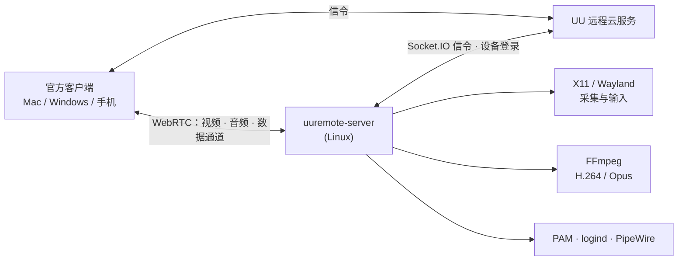

# uu-remote-linux · UU 远程 Linux 被控端 + 控制端（非官方）

**简体中文** | [English](README.en.md)

> **写在前面**
>
> 网易 UU 远程非常好用，但官网一直没有 Linux 版本。于是我借助 Claude 和 Codex，写了这个开源的 Linux 被控端：
> 装上之后，就能用官方的 Mac / Windows / 手机客户端远程控制你的 Linux 电脑。
> 现在还附带一个**实验性 Linux 控制端** `uuremote-viewer`：在 Linux 上用 UU 账号远控官方 Windows / Mac 被控端或本项目主机
> （桌面、文件传输、终端、端口映射、远程协助，详见[下文](#实验性原生控制端uuremote-viewer)）。
> 没有桌面的**群晖 / NAS** 也能用 Docker 部署：[部署指南](docs/deploy-nas-docker.md)，镜像 [`ghcr.io/vallierdev/uu-remote-linux`](https://github.com/VallierDev/uu-remote-linux/pkgs/container/uu-remote-linux)。
>
> 这是个人兴趣项目，**与网易无关，也不是官方客户端**。如果网易认为本项目侵权或有不妥，
> 请在推特私信我 **[@ai_fengshou](https://x.com/ai_fengshou)**，我会第一时间自行下架。

<p align="center"></p>
<p align="center"><sub>Linux 控制端：设备列表（设备名已打码）</sub></p>

<p align="center"></p>
<p align="center"><sub>Linux 被控端主窗口：远程协助与账号（设备 ID、验证码和账号已打码）</sub></p>

<!-- 截图占位：在官方客户端里远控 Linux 桌面的效果图。请自行截图并去掉账号、设备名等信息后放到
     docs/images/remote-desktop.png，再取消下面这行的注释。注意不要截入网易的图标和品牌素材。 -->
<!-- <p align="center"></p> -->

## 它是什么

- 一个纯 Rust 写的 Linux 原生程序（不需要 Wine，也不需要任何 Windows/macOS 组件）。
- 用你自己的 UU 远程账号扫码登录后，这台 Linux 会出现在官方客户端的设备列表里，用法和 Windows 被控端一样。
- 只做**被控端**：用来控制别人的客户端，仍然是官方的 Mac / Windows / 手机 App。

## 已实现的功能

| 功能 | 说明 |
|---|---|
| 主窗口与扫码登录 | 一个窗口包含「本设备」（远程协助）和「账号」两部分：未登录时显示扫码二维码，登录后显示账号并可退出登录；也可用 `login --no-gui` 在终端扫码 |
| 远程协助（实验性） | 像官方客户端一样，把**设备 ID + 验证码**发给别人，对方在 UU「开始协助」里输入即可连接；登录前（访客身份）和登录后都能用，见下文 |
| 远程桌面 | H.264 视频，NVIDIA 显卡用 NVENC 硬件编码，否则用 libx264；查看端绘制本地鼠标，不会出现双光标 |
| 鼠标 / 键盘 | 绝对/相对移动、点击、滚轮、按键；修复了网络延迟导致的按键连发；Wayland 下可用 uinput 虚拟键鼠（不依赖键盘布局，见下文） |
| Mac 快捷键 | **推荐**：在 Mac 远控窗口菜单里关闭「使用 macOS 快捷键」，之后和在 Mac 上一样：Cmd+C/V/A/F/X/Z 是复制、粘贴、全选、查找、剪切、撤销（终端里 Cmd+C/V 自动变成 Ctrl+Shift+C/V），Ctrl+C 在终端里始终是中断。保持开启时，客户端会把 Cmd 和 Ctrl 都当成 Ctrl 发送：终端里 Ctrl+V / Cmd+V 自动转成粘贴，Ctrl+C 是中断，复制用 Cmd+Shift+C（X11） |
| 鼠标指针样式 | 远端指针形状实时同步（X11） |
| 剪贴板 | 双向文本同步；Wayland 手机输入法输入通过剪贴板兜底粘贴，见下文 |
| 画质 / 帧率 / 分辨率 | 自动、原画 20M、超清 8M、高清 2M、自定义；30/60/90/144 帧；X11 下切换分辨率会像官方 Windows 被控端一样真正修改桌面分辨率（xrandr，缺少该模式时自动添加；选「原始」或断开后恢复），`UU_DESKTOP_RESIZE=0` 改为仅由编码器缩放；Wayland 仍由编码器缩放 |
| 声音 | 采集系统声音（PulseAudio / PipeWire），Opus 编码传到控制端 |
| 文件传输 | 上传、下载（含文件夹）、新建文件夹、重命名、删除 |
| 终端 | 官方「终端」工具，PTY 会话，支持多会话和重命名 |
| 锁屏与自动解锁 | 向控制端上报锁屏状态；开启「自动解锁被控端」后，通过 PAM 校验密码并解锁当前会话 |
| 远程结束后自动锁屏 | 设置保存在本机，重连后依然生效 |
| 被控端静音运行 | 主机扬声器静音，控制端照常能听到声音；结束后恢复原来的音量设置 |
| 系统操作 | 锁屏、显示桌面、任务管理器（系统监视器）、重启、关机（通过 `systemctl`，需要当前用户有 polkit 权限：通常本机有活动的图形会话即可；没有权限时直接失败并记日志，不会在被控端弹出密码框） |
| 端口映射 | 官方「端口映射」工具：把控制端本地端口转发到 Linux 能访问到的地址（如 127.0.0.1:22）；`UU_PORT_MAPPING=0` 可关闭 |
| 多次重连 | 每个工具窗口独立连接，互不影响 |
| 无头服务器 | 没有显示器也能上线，提供终端、文件传输和端口映射；也可以用 Xvfb 虚拟桌面提供完整远程桌面（见下文） |

桌面连接建立、结束及服务启动时会清理遗留输入状态；旧连接的迟到事件不能影响新的桌面连接。
X11 清理当前已认证显示上的按下状态（包括无法区分来源的实际按键）；uinput 仅清理本服务虚拟设备，
Portal 仅作用于本服务获授权的会话。文件传输、终端等独立工具连接不触发桌面松键。

## 支持的 Linux 桌面

| 桌面环境 | 显示协议 | 状态 | 编译方式 |
|---|---|---|---|
| GNOME（Ubuntu 24.04） | X11 / Xorg | ✅ 实机长期使用，以上功能全部验收 | 默认 |
| KDE Plasma | X11 | ✅ 虚拟机测试通过 | 默认 |
| Xfce | X11 | ✅ 虚拟机测试通过 | 默认 |
| Cinnamon / MATE | X11 | ✅ 虚拟机测试通过 | 默认 |
| Hyprland | Wayland（wlroots 原生协议） | 🧪 实验性，虚拟机测试（部分功能受限，见下） | `--features wayland` |
| niri | Wayland（wlroots 原生协议） | 🧪 实验性，协议支持已按 niri 源码确认，尚未实机验收（#55） | `--features wayland` |
| GNOME / KDE Plasma | Wayland（xdg-desktop-portal） | 🧪 实验性，验证范围与限制见下 | `--features wayland,portal` |

最后一列是源码编译方式；Release 预编译包已包含全部后端，直接使用即可（见[安装](#0-直接用-release-预编译包推荐x86_64)）。

GNOME Wayland 的 Portal/EIS 路径已在 Ubuntu 26.04、GNOME 50、单屏 4K/200% 缩放下验证画面和键鼠；锁屏冷连接自动解锁已用 Mac 和 iPhone 4.42.0 客户端实机验证，其余锁屏恢复及重连仍待验收。除 GNOME 的上述路径和 X11 外，其余桌面目前主要在虚拟机里测试。如果你在真机上遇到问题，欢迎[提交 issue](../../issues)，
请附上 `uuremote-server doctor` 的输出（v0.2.17 起；只含会话、后端、插件、权限、编码器等状态，不含账号、令牌或地址，可直接粘贴）和 `journalctl --user -u uuremote-native.service` 里的相关日志。

Wayland 下的限制：默认采集单屏，Hyprland 可按上文启用切屏；分辨率固定；Hyprland 原生后端默认使用双缓冲流水线 shm screencopy，控制端帧率设置会同步到采集节拍和编码器，但实际帧率仍受合成器、渲染和读回速度限制（旧串行路径在 2560x1600 曾测得约 16～22 帧；流水线只在虚拟机里测量过，不代表实机保证）；portal 后端暂不支持动态分辨率；GNOME 的屏幕唤醒与锁屏恢复见下；剪贴板只在控制端的远控窗口处于前台时同步。

**Wayland 手机输入法打字与剪贴板**：Wayland 下手机端输入法提交的文字（`text_input`）优先通过虚拟键盘空闲键码上屏；在 Portal（GNOME / KDE）或键码耗尽的环境下，自动通过「写系统剪贴板 + 触发 `Shift+Insert`（或 `UU_WAYLAND_PASTE_KEY=ctrl_v`）」兜底粘贴。**注意**：此兜底过程会覆盖被控端原有的剪贴板内容，且会被双向同步回传到控制端剪贴板；设置 `UU_WAYLAND_TEXT=0` 可完全关闭 Wayland 文字输入及该粘贴兜底。

GNOME 缩放桌面在使用 Portal 原生键鼠时，若支持 `ConnectToEIS` 和屏幕 `mapping_id`，通过同一授权会话的 EIS 接口注入输入，按匹配的区域与实际帧尺寸分别映射横纵坐标，没有固定分辨率或缩放倍率，可避免 `NotifyPointerMotionAbsolute` 在缩放时拒绝坐标。Portal 构建需要 libei ≥ 1.1。缺少 EIS 支持时保留旧输入路径及其既有缩放限制；其他初始化错误会明确报告并触发会话恢复。EIS 连接成功后全部输入统一使用 EIS。只采集画面或使用 uinput 时不会初始化 EIS；缺少可选的逻辑尺寸也不阻断采集。键盘沿用项目现有的 Windows VK → evdev 映射。恢复时保持编码器的采集帧尺寸不变，允许缩放后的逻辑尺寸变化。GNOME 显示配置变化后，已推流的 Portal 采集若持续「暂停且无有效格式」，会在关联通知后的 200 毫秒宽限结束后提前进入现有恢复流程；正常重协商恢复会取消提前判定，连续通知不会推迟同次异常的判定。未收到相关通知时保留五秒兜底；静态画面或有效格式下的暂停不会触发恢复。Ubuntu 26.04、GNOME Wayland 单屏 3840×2160 已实测保持连接切换 200%→166.67%→200%，恢复后画面持续更新且鼠标可控制全屏；切换期间会短暂停顿、黑屏后恢复，五秒是兜底判定阈值，并非总恢复时间。提前恢复的测量结果和验证范围见 [#35](../../pull/35)。此路径仍需实机验证锁屏恢复；多屏、连接中改变分辨率及旋转/镜像变换不属于本次修复范围。 捕获设置协议仍为版本 4：对客户端上报的分辨率统一使用像素坐标、DPR 为 1；Portal 逻辑尺寸仅用于本地输入映射。

GNOME Portal 的控制通道不再等待授权窗口或第一帧画面：先通知客户端当前选择桌面，再上报锁屏状态、接收官方客户端的「自动解锁被控端」请求。官方 Android 客户端需要桌面目标通知才会进入自动解锁流程，因此该通知不能等待采集就绪；真实屏幕尺寸、编码信息及采集权限仍按实际就绪状态上报。请在客户端启用自动解锁，使用当前 Linux 用户的登录密码；主机通过 PAM 验证后解锁当前 GNOME 会话、请求点亮屏幕，并恢复同一 Portal 会话中的画面、键鼠和剪贴板。首次授权或权限被撤销时仍需本机确认。物理或逻辑分辨率变化后需要重连。

桌面锁屏且尚未建立 Portal 时（冷连接），主机也会建立控制通道：上报锁屏状态并接受自动解锁，解锁后再恢复画面、键鼠和剪贴板。Portal 等待就绪期间，主机默认通过已协商的视频轨每秒发送一帧生成的纯黑画面，让官方 iPhone 客户端进入自动解锁流程，无需额外配置。Ubuntu GNOME Wayland 上已用官方 Mac 客户端验证；iPhone 4.42.0 的 H.265 冷连接完成了同一实验二进制「开启黑帧成功 → 关闭失败 → 再开成功」对照（[#29](../../issues/29)）。**局限**：黑帧不是真实 GNOME 锁屏画面，也不支持在锁屏界面操作原生键鼠；需要在 UU 客户端 控制中心 → 安全 → 自动解锁被控端 中启用自动解锁并输入密码。若本机没有已保存的 Portal 授权，解锁后仍需本机确认授权才能显示真实桌面。

无需修改现有熄屏和锁屏设置。主机仅在会话已解锁的采集恢复期间临时申请 GNOME 的 idle 抑制，拿到首帧后立即释放；锁屏、断开或初始化失败也会释放。远控窗口空闲时仍按原策略熄屏和锁屏，手动锁屏也继续生效。锁屏及锁状态未知时停止桌面输入并隐藏真实画面；独立终端、文件传输和端口映射连接不依赖画面初始化，也不会因桌面重连被关闭。这一恢复路径已覆盖自动化协议与生命周期回归测试，锁屏冷连接后的自动解锁与采集恢复已用官方 Mac 和 iPhone 4.42.0 客户端在 GNOME 实机验证，熄屏等其余场景仍待验收；不支持从整机挂起或休眠状态通过现有控制通道唤醒。

锁屏黑帧使用 FFmpeg 的 libx264/libx265 编码器（按已协商的 H.264/H.265 选择），硬件编码器可用并不代表这些软件编码器已安装。编码失败会明确记录日志。黑帧不改变采集权限或上报的真实屏幕尺寸；解锁或锁状态未知时暂停，采集就绪、拒绝或连接关闭时结束，再由真实视频接续同一条视频轨。对照实验与验证范围见 [#29](../../issues/29)、[#34](../../pull/34)。

原生 Wayland 后端需要合成器提供 `wlr-output-power-management` 才能唤醒已关闭的屏幕；缺少该协议不影响采集和编码。视频启动及运行期间，屏幕保活失败仅记录警告并在下轮重试，不终止视频；实际采集、编码或发送错误仍按原逻辑处理。

原生 Wayland 实验选项：`UU_WAYLAND_PIPELINE=0` 可关闭流水线做对照。`UU_WAYLAND_DMABUF=1` 显式尝试 dma-buf→GBM CPU 映射（默认关闭，需要运行时 libgbm；可用 `UU_WAYLAND_DMABUF_DEVICE` 指定 render node，默认 `/dev/dri/renderD128`）。仅支持显式线性修饰符、单平面 8-bit RGB，失败回退 SHM；virgl VM 中只验证了回退，成功导入/映射和硬件加速均未验证。这不是零拷贝 VAAPI 路径；选择 `UU_VIDEO_ENCODER=vaapi` 时仍由 FFmpeg 上传 CPU 帧。
首次连接时，桌面会弹窗请求「远程桌面 / 屏幕共享」授权，同意后会记住授权。

### 多显示器切换（实验性）

原生 Wayland 的绝对鼠标定位默认绑定正在采集的输出，修复双屏桌面下的点击偏移。uinput 可继续用于键盘、按键和相对移动。

设置 `UU_WAYLAND_MULTISCREEN=1` 后，手机端可选择并切换物理显示器；`UU_WAYLAND_OUTPUT` 指定默认屏幕。画面与绝对鼠标定位同步切换，支持不同分辨率、缩放和桌面位置。

X11 会话默认把所有显示器拼成一张画面。设置 `UU_X11_MULTISCREEN=1` 后，主机按 `xrandr --listmonitors` 列出各个显示器，控制端可选择其中一块，只采集该区域，绝对鼠标坐标加上该屏幕在桌面中的偏移；默认屏幕为主显示器，`UU_X11_OUTPUT` 可指定其他屏幕（如 `HDMI-1`）。显示器布局在主机启动时读取，改动后需重启服务。此模式下控制端的「分辨率」改为缩放画面，不再修改显示模式。实验性：目前只有单元测试与 Xvfb 虚拟显示器实测，尚未经官方客户端实机验收。

切屏复用同一条视频轨道，过渡期间暂停输入，发送新屏首帧后恢复；采集或编码失败、等待首帧超时会请求恢复原屏。当前通过 `hyprctl` 枚举未旋转的显示器，显示器插拔或布局变化后需重启服务。已在 Omarchy / Hyprland 上用官方手机客户端实测 2560×1440（125%）与 1920×1080（133.33%）双屏切换及点击。

## 尚未实现 / 不支持

| 功能 | 状态 |
|---|---|
| 多显示器切换 | Hyprland 原生 Wayland 后端与 X11（`UU_X11_MULTISCREEN=1`）实验性支持，见上文 |
| 真彩（4:4:4） | 支持（v0.1.15）：NVENC / libx264 的默认 FFmpeg 管线输出 H.264 High 4:4:4；`inproc-av` 原生 NVENC 输出 H.264 High 4:4:4 / HEVC FRExt；VAAPI 管线仍为 4:2:0，并如实回报给客户端 |
| HDR | 未实现 |
| 超级屏 / 虚拟显示器 | 未实现 |
| 被控端防窥模式 | 未实现 |
| 麦克风（控制端声音传到被控端） | 未实现（需要虚拟声卡） |
| 魔兽世界排队提醒等插件 | 不支持，会明确告诉客户端「无插件」 |
| Linux 系统登录界面 | 还不支持控制开机后的系统登录界面（还没有人登录 Linux 桌面时）；这种情况可以用无头模式或虚拟桌面（见下文）。注意：这里说的是 Linux 系统登录，**不登录 UU 账号**现在可以通过「远程协助」使用 |
| 跨运营商 / 受限网络的中继连接 | 已接入官方下发的 ICE 服务器，但复杂网络环境未充分测试 |
| 作为控制端（在 Linux 上控制别的电脑） | 🧪 实验性 `uuremote-viewer`，见[下文](#实验性原生控制端uuremote-viewer) |

## 安装

### 0. 直接用 Release 预编译包（推荐，x86_64 / aarch64）

**Ubuntu / Debian（v0.2.18 起）**：下载 `uu-remote-linux_<版本>_amd64.deb`（ARM64 选 `arm64`）后：

```sh
sudo apt install ./uu-remote-linux_<版本>_amd64.deb
uuremote-server login                                   # 用 UU 远程 App 扫码
systemctl --user enable --now uuremote-native.service   # 随图形会话启动
```

deb 会安装程序、插件、用户级 systemd 服务和应用菜单图标，并通过依赖自动装上 FFmpeg；uinput 权限不会自动开启（见第 5 步）。
GNOME / KDE 会把显示环境自动传给服务；Xfce 等不传的桌面需按第 4 步补 `DISPLAY`。

**其他发行版**：从 [Releases](../../releases/latest) 下载 `uu-remote-linux-<版本>-x86_64-linux.tar.gz`（ARM64 选 `aarch64-linux`），解压后用普通桌面用户（不要 root）运行：

```sh
cd uu-remote-linux-<版本>-x86_64-linux
./install.sh          # 加 --yes 不询问；--no-ffmpeg 只检查不安装
```

脚本把程序和插件装到 `~/.local`，写入用户级 systemd 服务（已有则保留），并检查 FFmpeg（需带 libx264，否则客户端会一直停在「正在传输画面」）。
缺 FFmpeg 时经 sudo 用 apt / pacman 安装；Fedora 需先启用 RPM Fusion，openSUSE 需 Packman 源，脚本只提示命令、不替你添加第三方源。
服务启动时和每次有人连接桌面时都会检查 FFmpeg：不可用就记 error，并弹桌面通知（没有通知服务时打开主窗口，顶部红字提示安装方法，最多每 5 分钟一次）；装好后重新连接即可，不用重启服务。

同一个包支持 X11、Hyprland 等 wlroots 合成器和 GNOME/KDE Wayland：程序启动时按当前会话自动选择后端，只在 Wayland 会话里
才加载对应的 `libuu-*.so`，X11 用户不需要任何 Wayland 库。系统要求：

| 会话 | 要求 |
|---|---|
| X11 | glibc ≥ 2.35（Ubuntu 22.04、Debian 12 及更新） |
| Hyprland / Sway / niri 等 wlroots | 同上，另需 `libwayland-client`、`libxkbcommon`（Wayland 桌面自带） |
| GNOME / KDE Wayland | glibc ≥ 2.39（Ubuntu 24.04、Fedora 40、Debian 13 及更新），以及 libei ≥ 1.1、PipeWire |

插件放在 `uuremote-server` 同目录、`../lib/uu-remote-linux/`、`~/.local/lib/uu-remote-linux/` 或 `/usr/lib/uu-remote-linux/` 都能找到
（`UU_ENGINE_DIR` 可指定）。缺库或版本太旧时日志会写明原因。之后从第 3 步「登录」继续；其他架构请按下面源码编译。

### 1. 依赖（Ubuntu / Debian）

```sh
sudo apt install build-essential pkg-config \
    libx11-dev libxext-dev libxtst-dev libxfixes-dev \
    libgtk-3-dev ffmpeg
# 可选：Wayland 后端
sudo apt install libwayland-dev libxkbcommon-dev wl-clipboard
# 可选：GNOME/KDE portal 后端
sudo apt install libglib2.0-dev libpipewire-0.3-dev libei-dev
# 可选：inproc-av 的 VAAPI/DRI3 引擎编译所需（libva 本体运行时加载）
sudo apt install libva-dev libgbm-dev libx11-xcb-dev libxcb-dri3-dev libxcb-damage0-dev
```

- 需要 Rust 工具链（<https://rustup.rs>）。
- `libgtk-3-dev` 是可选的：没有 GTK 时只能在终端里扫码登录（也可以设置 `UU_NO_GTK=1` 主动关闭登录窗口）。
- NVIDIA 显卡用户需要使用带 `h264_nvenc` 的 FFmpeg，否则自动回落到 CPU 编码（libx264）。

### 2. 编译

```sh
cargo build --release                         # X11
cargo build --release --features wayland      # + Hyprland
cargo build --release --features wayland,portal   # + GNOME/KDE Wayland
```

控制端的 `viewer-ffmpeg` 只支持 **FFmpeg 6.x**（`pkg-config --modversion libavcodec` 为 60.x）；FFmpeg 7 及以上会在依赖 `ffmpeg-sys-next` 里报 `avfft.h file not found`（#63）。
服务端可选的 `--features inproc-av` 是 X11 下的进程内硬件编码：不链接 FFmpeg 开发库，NVENC 运行时加载 NVIDIA 驱动库（`libcuda.so.1`、`libnvidia-encode.so.1`，需要支持 NVENC API 12.1 的驱动，530 及以上），VAAPI 运行时加载 `libva.so.2`/`libva-drm.so.2`。截屏与编码尺寸一致时 NVENC 直接读取 XShm 缓冲，省去一次主机到显存的拷贝；VAAPI 在同一特性下也进程内运行（DRI3 DMA-BUF 零拷贝，无 DRI3 时 XShm 上传，VPP 转 NV12 后送 VCN，支持 H.264/H.265）。CPU 编码或 `UU_CAPTURE=grab` 仍走外部 FFmpeg 进程；进程内硬件编码启动失败时先回退到对应的 FFmpeg 进程管线，再回退到 CPU。默认构建和预编译包都不需要该特性。

### 3. 登录

在图形桌面里运行：

```sh
./target/release/uuremote-server login
```

用手机上的 **网易 UU 远程 App** 扫码并确认即可。登录信息只保存在本机的
`~/.config/uuremote/config.json`（权限 0600）里。

### 4. 作为用户服务常驻

`~/.config/systemd/user/uuremote-native.service`：

```ini
[Unit]
Description=UU Remote Linux host (unofficial)
After=graphical-session.target
PartOf=graphical-session.target

[Service]
Environment=RUST_LOG=info
# GNOME/KDE 等桌面会把 DISPLAY / WAYLAND_DISPLAY 导入用户管理器，并启动 graphical-session.target
ExecStart=%h/.local/bin/uuremote-server
Restart=always
RestartSec=5

[Install]
WantedBy=graphical-session.target
```

```sh
install -Dm755 target/release/uuremote-server ~/.local/bin/uuremote-server
systemctl --user daemon-reload
systemctl --user enable --now uuremote-native.service
journalctl --user -u uuremote-native.service -f   # 看到 availability=Some("ready") 即上线
```

如果还没有登录，服务会自动在桌面上弹出扫码窗口。

Xfce、i3 等不启动 `graphical-session.target` 的桌面，按上面的写法开机不会自启：把 `[Install]` 改成 `WantedBy=default.target`，
并加上 `Environment=DISPLAY=:0`（按实际显示器填写），再重新 `enable`。下文的无头模式、虚拟桌面也要用 `default.target`。

### 5. Wayland 下使用 uinput 虚拟键鼠（推荐）

Wayland（尤其是 GNOME/KDE portal）下，默认的键鼠注入要经过 portal 授权，部分键盘布局下还会丢符号（比如下划线）。
允许当前登录用户访问 `/dev/uinput` 后，服务会自动改用内核级虚拟键盘和鼠标，发送物理按键码：

```sh
echo 'KERNEL=="uinput", SUBSYSTEM=="misc", OPTIONS+="static_node=uinput", TAG+="uaccess"' | \
    sudo tee /etc/udev/rules.d/60-uu-remote-linux-uinput.rules
sudo udevadm control --reload && sudo udevadm trigger --name-match=uinput
```

`uaccess` 只把权限给当前坐在这台机器前的登录用户。`UU_INPUT_BACKEND=uinput|native` 可以强制指定后端。
X11 默认继续用 XTest，因为它能正确处理网络延迟下按住不放的按键。

## 远程协助与主窗口（实验性）

和官方客户端的「远程协助」一样：本机显示**设备 ID** 和**验证码**，把它们发给信任的人，对方在 UU 远程的「开始协助」里输入即可控制本机。

- **未登录**：启动后直接显示主窗口，用访客身份提供远程协助，同时显示扫码登录二维码。扫码登录后自动切换到账号模式。
- **已登录**：本机出现在你的设备列表里，可以直接连；远程协助也照常可用（同一设备 ID）。服务在后台运行时窗口默认隐藏，用 `uuremote-server show` 或应用菜单里的「UU 远程 Linux 主机」打开。关闭窗口只是隐藏，不会停止服务。
- **托盘图标**：后台运行时顶栏/任务栏有托盘图标，菜单里可以「打开主窗口」、切换「允许他人远程协助」、「退出」。GNOME 需要 AppIndicator 扩展（Ubuntu 自带），Xfce / Cinnamon / KDE 直接可用。从托盘退出会停止 `uuremote-native.service`，之后从应用菜单打开会重新启动服务。
- **设置**（与官方一致）：「允许他人远程协助」开关（默认关闭）；验证方式：仅临时验证码 / 仅自定义验证码（8–16 位，需同时包含字母和数字） / 两种都可以；临时验证码自动刷新：每次远控结束 / 每小时 / 每 12 小时 / 每 24 小时 / 不刷新；ID 和验证码旁各有「复制」按钮。设置保存在本机配置文件（0600）。
- **只在本机窗口显示**：验证码不会写进日志。没有图形界面时，单独运行 `uuremote-server assist` 会在终端显示（`allow` / `deny` / `reset` / `mode …` / `refresh …` / `off`）。
- **安全**：拿到 ID 和验证码的人可以完全控制这台电脑（桌面、文件、终端）。只发给信任的人，用完关掉开关或刷新验证码。

安装应用菜单图标（可选）：

```sh
install -Dm644 contrib/desktop/uu-remote-linux.svg ~/.local/share/icons/hicolor/scalable/apps/uu-remote-linux.svg
install -Dm644 contrib/desktop/uu-remote-linux.desktop ~/.local/share/applications/uu-remote-linux.desktop
install -Dm644 contrib/desktop/uu-remote-linux-viewer.desktop ~/.local/share/applications/uu-remote-linux-viewer.desktop
```

验证情况：访客身份下的连接、错误验证码拒绝、用完换码、关闭后不可连接、登录与退出登录的切换，已用官方 Mac 客户端实测通过。
**登录状态下的远程协助尚未用另一个账号实测**（同一账号的设备不能互相发起远程协助，这是官方限制）。

## 没有显示器的服务器

**无头模式**：只要终端、文件传输和端口映射，不需要图形界面。在服务里加 `Environment=UU_DESKTOP_BACKEND=none`，
把 `[Install]` 改成 `WantedBy=default.target`（无人登录时 `graphical-session.target` 不会启动），再执行 `loginctl enable-linger $USER`，这样开机后不用登录，systemd 用户服务（以及 `XDG_RUNTIME_DIR`、用户 D-Bus）也会自动启动。
无头模式下控制端点「远程桌面」会一直显示正在连接，这是正常的。首次登录用 `uuremote-server login --no-gui` 在终端里扫码。

**群晖 / NAS（Docker）**：没有桌面的 NAS 可以用容器运行无头模式（文件传输、终端、端口映射）。
镜像 [`ghcr.io/vallierdev/uu-remote-linux`](https://github.com/VallierDev/uu-remote-linux/pkgs/container/uu-remote-linux)，
**部署步骤见 [群晖 / NAS 部署指南](docs/deploy-nas-docker.md)**。已在群晖 DSM 7.3（x86_64）上实测三项功能。

**Mac 终端粘贴文件**：使用 Ghostty 通过 UU 端口映射连接 SSH 时，可安装
[Mac SSH 粘贴助手](contrib/macos-ssh/README.md)。在 Finder 复制文件后按 Command-V，
助手先通过同一个 SSH 别名上传文件，再插入服务器路径；普通文本和鼠标报告正常透传。
Ghostty 标题栏和进度条显示上传进度、已传大小、速度和耗时。
这是可选的 Mac 端工具，不会改变官方 UU 内置终端；暂不支持文件夹、拖放或原始截图剪贴板。

**虚拟桌面**：需要完整的远程桌面时，用 Xvfb 创建一块虚拟屏幕，再在上面跑一个桌面环境（推荐 Xfce）：

```sh
sudo apt install xvfb xauth x11-utils dbus-x11 dbus-user-session xfce4      # 或其他桌面环境，用 UU_VIRTUAL_SESSION 指定
install -Dm755 contrib/virtual-desktop/uu-virtual-desktop ~/.local/bin/uu-virtual-desktop
install -Dm644 contrib/virtual-desktop/uu-virtual-desktop.service ~/.config/systemd/user/uu-virtual-desktop.service
install -Dm644 contrib/virtual-desktop/virtual-display.conf ~/.config/systemd/user/uuremote-native.service.d/virtual-display.conf
loginctl enable-linger $USER
systemctl --user daemon-reload && systemctl --user enable --now uu-virtual-desktop.service
systemctl --user restart uuremote-native.service
```

虚拟屏幕默认是 `:99`、1920x1080。Xvfb 没有 GPU 加速，流畅度比真实显示器略差；有 NVIDIA 显卡时视频仍然用 NVENC 编码。
脚本会把 `DISPLAY` 导入 systemd 用户会话，这样通过 D-Bus 启动的程序也会显示在虚拟屏幕上；
如果这台机器同时还有真实的桌面会话，请设 `UU_VIRTUAL_BUS=private`，避免影响真实桌面。

想让 NVIDIA/AMD 显卡在不接显示器时也正常输出画面（而不是用 Xvfb），可以用假显示器插头（HDMI 诱骗器），
或者用内核参数 `drm.edid_firmware=` 加载 EDID 文件，再按普通 X11 桌面的方式安装。

## 配置

常用环境变量：

| 变量 | 作用 |
|---|---|
| `UU_CONFIG` | 配置文件路径（默认 `~/.config/uuremote/config.json`） |
| `UU_DESKTOP_BACKEND` | `auto` / `x11` / `wayland` / `portal` / `kms`（实验性特性） / `none`（无头模式） |
| `UU_DESKTOP_RESIZE=0` | X11 下控制端切换分辨率时不改桌面分辨率，只缩放编码画面 |
| `UU_NVENC_RGB=0` / `=1` | NVENC 直接编码 BGRA（省 CPU）。显示器接在 NVIDIA 卡上时默认关闭（同卡合成时直吃反而更慢），`0` 强制关，`1` 强制开 |
| `UU_WAYLAND_MULTISCREEN=1` | 启用 Hyprland 物理显示器切换（默认关闭） |
| `UU_WAYLAND_OUTPUT` | 原生 Wayland 默认采集输出名称，例如 `HDMI-A-1` |
| `UU_X11_MULTISCREEN=1` | X11 下按显示器分别选择和采集（实验性，默认关闭，需要 `xrandr`） |
| `UU_X11_OUTPUT` | X11 默认采集的显示器名称（`xrandr --listmonitors`），默认主显示器 |
| `UU_WAYLAND_NO_VIRTUAL_KEYBOARD=1` | 原生 Wayland 不创建虚拟键盘（如 Denial 只把它给自己的输入法），键盘改走 uinput。合成器没有 wlr-virtual-pointer 时鼠标也自动改走 uinput（#72） |
| `UU_INPUT_BACKEND` | `auto`（默认，Wayland 下可用时用 uinput）/ `uinput` / `native` |
| `UU_TERMINAL_SHORTCUTS=0` | 关闭终端窗口里的 Ctrl+V 粘贴转换 |
| `UU_VIDEO_ENCODER` | `cpu` 强制 CPU；`vaapi` 显式启用 Intel/AMD 硬编；`nvenc` 强制 NVENC；未设置或 `auto` 时后台探测（每个候选编码一帧，限时 3 秒）。有 NVIDIA 驱动时顺序是 NVENC → CPU；没有 NVIDIA 时只有 CPU，不探测。探测未完成就建流则沿用旧规则（有 NVIDIA 用 NVENC，否则 CPU）。自行编译的 `--features inproc-av` 上，仅 X11 会先走进程内引擎：外部 FFmpeg 探测失败时记为 `native_unprobed`，沿用旧规则（NVENC）；Wayland、portal、KMS 回退 CPU。只有 CPU 时跳过探测，记为 `not probed (only candidate)`。探测成功和这种只含 CPU 的跳过会缓存到 NVIDIA 是否存在发生变化为止（`/proc/driver/nvidia/version` 或 `/dev/nvidia0`）。之后的桌面连接在后台再探测一次（不挡住这一路，仍用缓存的编码器）。NVENC 探测失败、选用 CPU 时只缓存 10 分钟；到期后下一次桌面连接同样在后台再探测一次，再次失败则重新计 10 分钟。显式 `cpu` / `vaapi` / `nvenc` 不启动探测。`native_unprobed` 不算失败缓存。优先级低于 `host_settings.json` 里非 `auto` 的 `video_encoder`。VAAPI 要等 #33 解决后才会进入 auto |
| `UU_VAAPI_BUFFER_MS` | VAAPI 的 VBV 缓冲（10–1000 ms，仅 `UU_VIDEO_ENCODER=vaapi` 时生效）；高分辨率下关键帧被压糊时用它换稳定画质 |
| `UU_NVENC_BUFFER_MS` | NVENC 的 VBV 缓冲（10–1000 ms，仅 NVENC 生效，含进程内引擎）；默认 100–500 kbit，1440p 等高分辨率下关键帧被压糊、按 GOP 周期闪烁时设 `1000`（#103） |
| `UU_FFMPEG_ROOT` | 使用指定目录下的 FFmpeg |
| `UU_AUDIO=0` | 关闭声音转发；`UU_AUDIO_SOURCE` 指定 PulseAudio 采集源 |
| `UU_LOGIN_WINDOW=0` | 凭证缺失时不自动弹出登录窗口 |
| `UU_REMOTE_ASSIST=0` | 关闭远程协助（未登录时也不再以访客身份提供协助） |
| `UU_ASSIST_ALLOW=1` | 启动时就允许他人远程协助（覆盖窗口里保存的开关状态） |
| `UU_PORT_MAPPING=0` | 关闭端口映射（对应官方被控端的开关） |
| `UU_WOL_HELPER=1` | 实验性：让这台主机像官方 Windows 被控端一样充当「远程开机」辅助设备——登录后向网易上报本机局域网信息，收到云端唤醒请求时向同一局域网发送唤醒包（未经端到端验证） |
| `UU_USE_PROXY=1` | 使用环境变量里的 HTTP/SOCKS 代理；默认忽略代理、直连网易服务器 |

「远程结束后自动锁屏」「静音运行」等设置保存在 `~/.config/uuremote/host_settings.json`。同一文件里的 `video_encoder`（`auto`/`cpu`/`vaapi`/`nvenc`）和 `video_codec`（`auto`/`h264`/`h265`）用 `uuremote-server set-encoder`、`uuremote-server set-codec` 写入（非法参数退出码 2）。非 `auto` 的值优先于 `UU_VIDEO_ENCODER` / `UU_VIDEO_CODEC`；`auto` 或留空则落到环境变量，再落到 auto（有 NVIDIA 时 NVENC 优先，失败再 CPU；没有 NVIDIA 时就是 CPU，不探测；codec 仍是硬件优先 H.265、CPU 用 H.264）。探测在启动时后台进行，不挡住第一路出图。成功结果缓存到进程退出，但 NVIDIA 是否存在（`/proc/driver/nvidia/version` 或 `/dev/nvidia0`）与报告不一致时，下一次桌面连接会在后台再探测一次（`warm_auto_probe`），这一路仍用缓存的编码器，直到新结果写入。NVENC 失败只缓存 10 分钟，到期后的桌面连接同样在后台再探测一次，这一路仍用当前结果。`set-encoder` 和 `set-codec` 写完后若 `host.pid` 指向正在运行的本程序，都会发 `SIGUSR2`：编码器变化时进行中的桌面流立刻换编码器（不断开，沿用本会话已协商的 codec；新编码器起不来时按进程内 → FFmpeg 进程 → CPU 回退）。手改文件后可 `kill -USR2 $(cat ~/.config/uuremote/host.pid)`。`SIGUSR2` 不重新探测。codec 偏好仍在下次建立桌面连接时生效（运行中的 host 只记日志，不重开编码）。显式 `vaapi` 请求真彩时仍用 VAAPI、编码 4:2:0，并在 CaptureSettingSync 的 field 3 回报 4:2:0。所选编码器在本机不可用时，建流回退 CPU 并记 warning。VAAPI 进入 auto 要等 #33。

自定义码率按客户端选择的 Mbps 生效，例如 1 Mbps 对应 1000 kbit/s 的编码上限。

选择码率档（原画 / 超清 / 高清 / 自定义）时，外部 FFmpeg 的 CPU 编码以平均码率（ABR）为目标，避免 4K 低码率下关键帧发灰；「自动」档仍使用恒定质量（CRF）。

本地编码诊断 `desktop-video-probe [output.h264]` 可设置 `UU_PROBE_FPS`、`UU_PROBE_FRAMES`（默认 5）和 `UU_PROBE_QUALITY`（1–5）；设置 `UU_PROBE_INPUT=clip.y4m`（也支持 `.mp4`、`frames/%05d.png`）可绕过桌面采集，以相同的生产 FFmpeg 编码参数测量固定输入并打印分辨率和编码统计，`UU_PROBE_LOOP=1` 循环到指定帧数，输入无法打开或帧数不足时以非零状态退出（固定输入始终使用外部 FFmpeg 管线）。

## 让 AI 帮你安装或开发

如果你用 Claude Code、Codex、Cursor 等 AI 编程工具，让它先阅读 [AGENTS.md](AGENTS.md)。
这份文档写给大模型看，里面有编译安装步骤、代码地图、协议要点和开发规范，读完就能接手编译安装或继续开发。

## 工作原理



- 主机以「Windows PC」类型注册到 UU 远程，官方客户端因此能直接识别它。
- 画面经 FFmpeg 编码成 H.264，声音编码成 Opus，都通过 WebRTC 发送；键鼠、剪贴板、文件和终端走 WebRTC 数据通道。
- 协议细节通过观察官方客户端的通信，以及分析其公开发布的程序得到，仅用于实现互通。
  本仓库**不包含**任何网易的程序、图标或素材。

## 安全与隐私

- 日志不记录键盘输入、终端内容、剪贴板内容、文件内容、密码和令牌。
- 自动解锁的密码保存在**控制端**（官方客户端）里，被控端只拿来做一次 PAM 校验，不落盘、不写日志。
- 能连上这台机器的，只有登录了同一个 UU 账号的设备。请保管好你的 UU 账号。

## 许可证

本项目以 [GPL-3.0](LICENSE) 许可证发布：可以自由使用、修改和再发布，但再发布（包括修改后的版本）必须同样以 GPL-3.0 开源。

## 免责声明

- 「网易」「UU 远程」等名称和商标归网易公司所有。本项目与网易公司没有任何关联，未获其授权或认可。
- 本项目基于互操作目的开发，请在遵守 UU 远程用户协议和当地法律的前提下使用，风险自负。
- 网易或权利人如有异议，请通过推特 [@ai_fengshou](https://x.com/ai_fengshou) 联系，我会配合处理或下架。

## 致谢

- 网易 UU 远程团队：做了一个好用的远程工具。
- [webrtc-rs](https://github.com/webrtc-rs/webrtc)、FFmpeg、GTK 等开源项目。
- 本项目的大部分代码在 Claude 和 Codex 的协助下完成。

### H.265 / HEVC

控制端和主机都支持 H.265、且主机使用硬件编码器（NVENC / 显式 VAAPI）时，主机自动使用 H.265（与官方主机一致，由主机按双方能力选择；官方 Mac 客户端在 SDP
中优先列出 H.265）。**只有 CPU 编码时默认用 H.264**：libx265 比 libx264 慢约 10 倍（4 核 ARM 上 1080p 实测约 15 帧对 155 帧，#59），
可用 `UU_VIDEO_CODEC=h265` 强制 H.265。实际帧率由控制端的「画质/帧率」菜单决定；`UU_DISPLAY_FPS` 只改上报的显示器刷新率。首次桌面连接会用合成帧探测实际编码能力，并通过 CodecNegotiation 告知客户端。支持 `hevc_nvenc`、
`libx265`、显式 `UU_VIDEO_ENCODER=vaapi` 的 `hevc_vaapi`；硬件失败先回落软件 HEVC，再回落 H.264。
`UU_VIDEO_CODEC=h264` 强制使用 H.264。8-bit；真彩 4:4:4 使用 hevc_nvenc `rext` / libx265 `main444-8`。
已用官方 Mac 客户端在 RTX 3090（hevc_nvenc，含 4:4:4）实机验收；`hevc_vaapi` 配官方 Android 客户端也已实机验收
（Intel Alder Lake-P / iHD，2560×1440 全程硬件编码，客户端 58 fps 解码、约 10 ms 延迟）；`libx265` 仍未经控制端验收。

HEVC 的访问单元按 RFC 7798 的图片边界切分，不依赖 AUD：`hevc_vaapi` 带 `-aud 1` 时只在 IRAP 处写 AUD，并把其余
画面从码流里丢掉，读取端按 AUD 切分就会把整个 GOP 当成一帧，再被 IRAP 门控全部拒绝——对外表现为连接停在
「正在传输画面」，而主机侧只有约 12 kbit/s。`UU_VIDEO_CODEC=h265` 可显式选中 H.265，便于对照排查。

### VAAPI 硬件编码

`UU_VIDEO_ENCODER=vaapi` 或 `set-encoder vaapi` 显式选择 Intel/AMD H.264 VAAPI。
`UU_VAAPI_DEVICE` 默认 `/dev/dri/renderD128`，运行用户需要 render 节点权限。
`auto` 有 NVIDIA 驱动时是 NVENC → CPU，没有 NVIDIA 时是 CPU。VAAPI 只通过显式选择启用，进入 auto 要等 #33。
设备或驱动初始化失败会明确警告并回退 libx264。外部 FFmpeg 先转 NV12 再上传硬件帧。
VBR 使用控制端码率预设及 CQ 对应的最小 QP，无 B 帧、async depth=1，并保留现有 GOP/VFR 规则。
Intel 核显（UHD 770，iHD 驱动）已实机验收：默认的外部 FFmpeg 管线用官方 Mac 控制端测试了各档画质、帧率、缩放和重连，全程硬件编码、无回退，CPU 占用比 libx264 低约 40%（该数字为 FFmpeg 进程管线时代的测量）。AMD 核显已在**进程内原生引擎**上实机验收（`--features inproc-av`）：官方 Mac 客户端的端到端会话在 HawkPoint（Mesa 26.2.3）与 Cezanne（Mesa 26.2.5）上通过验收（HEVC，含画质档、帧率、缩放）；Cezanne 上另以探测验证了 H.264 与两条采集路径——XShm 上传（码流可解码、画面正确）与 DRI3 DMA-BUF 零拷贝导入。同机实测（1920×1200@60，Cezanne iGPU + RTX 3050 Ti 双显卡）：进程内 VAAPI 每帧编码 CPU 约为 libx264（FFmpeg 管线 superfast）的 **1/12**、进程内 NVENC 的 **1/5**；外部 FFmpeg 进程管线（预编译包使用）在 AMD 上未单独验证。

高分辨率下 VAAPI 的默认 VBV 缓冲（100–500 kbit）会把关键帧压得过狠：2560×1440 H.264 VAAPI、30M
上限、静止画面上实测首个 IDR 只有 59,910 字节，画面每隔一个 GOP 糊一下再慢慢恢复。设
`UU_VAAPI_BUFFER_MS=250`（按 `码率上限 × 毫秒 / 1000` 放大 VBV）后首个 IDR 为 142,397 字节，
最低帧 Y-SSIM 从 0.9492 升到 0.9933，平均码率没有上升。默认不启用，未设置或超出 10–1000 ms
仍用原缓冲；代价是关键帧变大，弱网下可能出现瞬时排队，建议从 250 ms 试起。

### 静音运行与虚拟声卡

控制端开启「静音运行」后，程序创建虚拟输出 `uu-remote-sink`，保存原默认输出，
迁移其播放流并采集 `uu-remote-sink.monitor`。新播放也走虚拟输出；其他输出上的流不迁移。
最后一个桌面连接结束后恢复原默认输出并卸载模块；`mute_permanent` 仍保留原物理静音策略。
恢复记录保存在配置旁，权限 0600；进程锁避免重复实例抢占，异常退出后下次启动会恢复遗留路由。
有 `pactl` 时用它（PulseAudio / PipeWire-pulse）；没有 `pactl` 的纯 PipeWire 系统（如默认的 Ubuntu 桌面）
自动改用 `pw-cli`/`wpctl` 创建同名虚拟输出，正在播放的声音由 WirePlumber 自动迁移。已在 Ubuntu 24.04 实机上用官方 Mac 控制端验收。
路由失败时保留原静音/monitor 方案。开关变化仅重启当前音频编码器，未开启时采集方式保持不变。
本地诊断命令 `virtual-audio-probe` 会临时切换输出五秒并恢复。

### 虚拟桌面的用户总线

默认 `UU_VIRTUAL_BUS=user`：监督脚本将 DISPLAY/XAUTHORITY 导入 linger 用户总线，等待经过认证的
X11 就绪后通知 systemd；退出时清理 Xvfb。示例主机 drop-in 使用 `%t/uu-virtual-99.Xauthority`。
请使用没有真实图形会话的专用账号；参见[设置与官方 Mac 验收清单](contrib/virtual-desktop/ACCEPTANCE.md)。

### Arch Linux / Omarchy

```sh
sudo pacman -S --needed base-devel rust pkgconf clang ffmpeg libx11 libxext libxtst libxfixes gtk3 \
  wayland libxkbcommon wl-clipboard libpipewire glib2 libpulse
cargo test --locked --features wayland
cargo build --release --features wayland
```

Omarchy 使用 Hyprland：在其用户会话中运行，设置 `UU_DESKTOP_BACKEND=wayland`，保留
`WAYLAND_DISPLAY` 和 `XDG_RUNTIME_DIR`。其他合成器可能需要 `--features wayland,portal`。
uinput 需加载内核模块（开机自动加载：`echo uinput | sudo tee /etc/modules-load.d/uinput.conf`）并应用上文 uaccess 规则；无人登录账号需要专用组的受限授权，
例如 `/etc/tmpfiles.d/uinput.conf` 写入 `z /dev/uinput 0660 root uinput`，再 `sudo usermod -aG uinput <用户>`（只加专用账号）。
该权限能向整个 seat（包括锁屏/登录界面）注入输入。设置 `UU_INPUT_BACKEND=uinput` 后，
仍须确认启动日志实际选择了 uinput。

Hyprland / uwsm 等会话中，`default.target` 可能早于合成器导出 `WAYLAND_DISPLAY`。systemd 单元可改为随图形会话启动
（社区在 Omarchy 上验证过开机自启）：

```ini
[Unit]
After=graphical-session.target
PartOf=graphical-session.target
ConditionEnvironment=WAYLAND_DISPLAY

[Service]
Environment=UU_DESKTOP_BACKEND=wayland
# 其余同上文 X11 示例，去掉 DISPLAY

[Install]
WantedBy=graphical-session.target
```

单元名请保持 `uuremote-native.service`，不要写成模板单元 `uuremote-native@.service`：桌面图标和 `uuremote-server show`
固定启动这个名字（`UU_SERVICE_UNIT` 可覆盖），systemd 不会把它解析到模板实例。niri 的 `niri --session` 同样会在就绪前导入
`WAYLAND_DISPLAY`，上面的写法也适用（#55）。

VAAPI 可选包：Intel 新显卡用 `intel-media-driver`，AMD 用 `libva-mesa-driver`，`libva-utils` 提供
`vainfo`。KMS 依赖 `libdrm`。虚拟 Xfce 依赖 `xorg-server-xvfb xorg-xauth xorg-xdpyinfo
xfce4-session xfce4-panel xfdesktop xfwm4 gnome-terminal`。
若编译包含 `viewer-ffmpeg`，滚动 Arch 的 FFmpeg 可能超出其支持的 6.x；请使用独立的 FFmpeg 6 前缀，不要降级系统 FFmpeg（服务端的 `--features inproc-av` 原生 NVENC 不依赖 FFmpeg）。

### 实验性 KMS 截屏

编译 `--features kms` 后显式设置 `UU_DESKTOP_BACKEND=kms`；`UU_KMS_DEVICE` 默认
`/dev/dri/card0`。需要 libdrm、card 节点访问权及主动授予的 `cap_sys_admin+ep`。
程序不会自动启用或授权；此 capability 权限很大，此 capability 权限很大：它作用于整个联网的服务进程，也能看到登录界面/锁屏等原本受授权保护的画面；只在可丢弃的机器上、对审查过的二进制使用，用 `getcap` 检查，`sudo setcap -r <路径>` 撤销。目前在虚拟机里登录界面截图全黑，不支持锁屏/登录界面。
当前仅为线性帧缓冲原型：VM 的 GDM 截图仍是黑屏，**没有通过登录界面视觉验收**，不承诺锁屏可用。
键鼠需 uinput；没有桌面会话时不提供剪贴板。
无头模式下桌面连接没有找到官方的「无桌面」错误码，因此保持原有 offer 行为。

## 实验性原生控制端（uuremote-viewer）

`uuremote-viewer` 是 Linux 上的**控制端**：用你的 UU 账号连接并控制其他设备（官方 Windows / Mac 被控端，或本项目的 Linux 主机），
也可以凭对方的设备 ID 和验证码发起远程协助。它是实验性功能，与主机 `uuremote-server` 相互独立，默认主机构建和行为不变。

**获取**：Release 包从本版本起附带 `uuremote-viewer`（x86_64）。运行时需要 GTK3、SDL2（Ubuntu/Debian：`libsdl2-2.0-0`）和
`ffmpeg` 命令；SDL 桌面窗口直接同步文本剪贴板（Wayland/X11），无需额外剪贴板工具；终端功能需要本机终端程序（可用 `TERMINAL` 指定）。
从源码构建：`sudo apt install libsdl2-dev`，然后 `cargo build --release --locked --features native-viewer,viewer-sdl --bin uuremote-viewer`。

SDL 剪贴板复用桌面窗口，避免 GNOME Wayland 上临时窗口引起的 Dock 跳动（#37）。仅在桌面窗口获得焦点时同步，
保留 30 KiB 文本上限；跳过不含支持的文本格式的本地选择，空文本的识别取决于 SDL2 后端。不带 SDL 的构建保留命令后端。
SDL2 同步读取选择内容，慢速的剪贴板提供者可能暂时阻塞窗口，桥接超时无法中断该原生调用。
GNOME 与官方 Mac 被控端的双向剪贴板尚未验证通过；此修改不解决被控端兼容问题。

**使用**：
- `uuremote-viewer login`：扫码登录（复用同目录下 `uuremote-server` 的登录窗口；`--no-gui` 为终端二维码）。控制端与主机共用
  `~/.config/uuremote/config.json`（可用 `UU_CONFIG` 另指定），因此**不能用同一身份连接本机上的主机**；控制其他设备不受影响。
- `uuremote-viewer ui`：启动窗口，列出账号下的设备，可进入桌面、只看模式、文件传输、终端、端口映射、重启/关机、远程协助。
- 命令行：`connect DEVICE false - echo legacy [--view-only]`（桌面）、`files DEVICE ls|get|put …`、`terminal DEVICE [SESSION]`、
  `terminal-ui DEVICE NAME`、`portmap DEVICE LOCAL_PORT HOST PORT`（只监听 127.0.0.1）、`power DEVICE reboot|shutdown`、`unbind DEVICE`（从账号删除设备，启动窗口「更多工具」里也有）、
  `assist CONNECT_ID`（验证码从 stdin 读取一行，不能作为参数传入）。`uuremote-viewer --help` 查看全部参数。
- **安全输入 `type`**（向已打开的桌面会话注入键盘，适合锁屏 PIN / 密码；文本永不进 argv）：
  ```sh
  # 推荐：先 ui/connect 打开桌面，再 type（复用会话，不顶掉当前画面）
  UU_INPUT_ENV=UU_SECRET UU_SECRET='……' \
    uuremote-viewer type DEVICE [--delay-ms 40] [--omit-last 1] [--snapshot /path/out.png]
  # 或：printf '%s' '……' | uuremote-viewer type DEVICE
  # 只检查、不连网：uuremote-viewer type DEVICE --dry-run
  # 没有正在运行的桌面会话时必须显式：--new-session（会新开连接，并顶掉已打开的桌面窗口，见上游 #30）
  ```
  特殊键用花括号：`{Enter}` `{Tab}` `{Esc}` `{Backspace}` `{Ctrl+Alt+Del}` 等；`{{` 表示字面 `{`。
  **布局**：字符按 **US QWERTY** 物理键位映射（非美式布局的符号/字母可能对不上）。
  **Windows 数字 PIN**：输满位数后系统常会自动提交，一般不必再发 `{Enter}`；若只想填入、不登录，用 `--omit-last N` 省略最后 N 个字符。
  日志与 `--dry-run` 输出只含长度/事件数，不含明文。复用会话时，发送约 1 秒后会保存一帧 PNG（默认写在 `$XDG_RUNTIME_DIR/uu-viewer-type/`，权限 0600），路径打在日志并打印 `snapshot=…`。
- 桌面窗口中按 Ctrl+Alt+F 打开文件窗口（复用同一连接）。`UU_VIEWER_AUDIO=0` 关闭声音，`UU_VIEWER_CLIPBOARD=0` 关闭剪贴板，
  `UU_VIEWER_VIEW_ONLY=1` 只看不控，`UU_VIEWER_FFMPEG` 指定 ffmpeg 路径。
- 桌面同时提供 H.264 / H.265，由主机协商选择；`UU_VIEWER_CODEC=h264` 将 SDP 和解码能力限制为 H.264。
  默认请求 4:2:0；`UU_VIEWER_CHROMA=444` 在 CONTROL 打开后请求真彩（4:4:4）。主机可能回落到 4:2:0，
  以 CaptureSettingSync 回报为准。两种色度均由 FFmpeg 转为 RGB24 显示。

Mac 目标使用 macOS 原生键码，Windows / Linux 目标保留 Windows VK。键盘按物理键位置转发，不自动把 Ctrl 改成 Command；
控制 Mac 时，PC 键盘的 Super / Win 键对应 Command。仅接受已验证的目标平台值 1（Windows / 本项目 Linux 主机）和 4（Mac），
未知值会报错，不猜测键码。账号连接缺少平台字段时查询目标设备；远程协助必须由连接响应提供平台。只看模式不需要此识别。
媒体键和部分 JIS 专用键尚未映射；远程协助的 Mac 平台识别及 ISO / JIS 键盘尚未实机验收。

**已实测**（作者环境，非全面验收）：
| 功能 | 官方 Windows 被控端 | 官方 Mac 被控端 | 本项目 Linux 主机 |
|---|---|---|---|
| 桌面画面（H.264） | ✅ | ✅ | ✅ |
| H.265、4:4:4 真彩 | — | — | ✅（虚拟机，libx265） |
| 键盘、鼠标 | ✅ | — | ✅ |
| 文件列表 / 下载 / 上传 | ✅ | — | ✅ |
| 端口映射、终端 | ✅（终端为 PowerShell） | — | ✅ |
| 剪贴板（文本） | 仅被控端 → 控制端；控制端 → Windows 未生效 | — | ✅ 双向（虚拟机） |
| 声音 | 未确认（被控端未播放声音时没有音频包） | — | ✅（虚拟机） |
| 远程协助（ID + 验证码） | — | — | ✅（虚拟机，访客主机） |
| 终端会话列表（新建、双击接回、结束） | — | — | ✅（虚拟机） |
| 重启、关机 | — | — | ✅（虚拟机） |
| Wayland 下的桌面窗口与剪贴板 | — | — | ✅ Hyprland、KDE；GNOME 窗口正常，剪贴板已于 v0.2.3 改为 SDL 直连（#37，最终版本未重新实机验收） |

「—」表示尚未测试。重启/关机只应在可以重启的机器上使用。**未实测**：官方被控端的 H.265 / 4:4:4、多显示器。日志只记录字段号、大小和状态，不记录键盘、剪贴板、文件内容、验证码或凭据。
