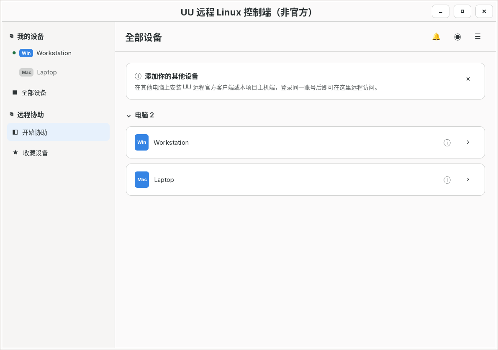
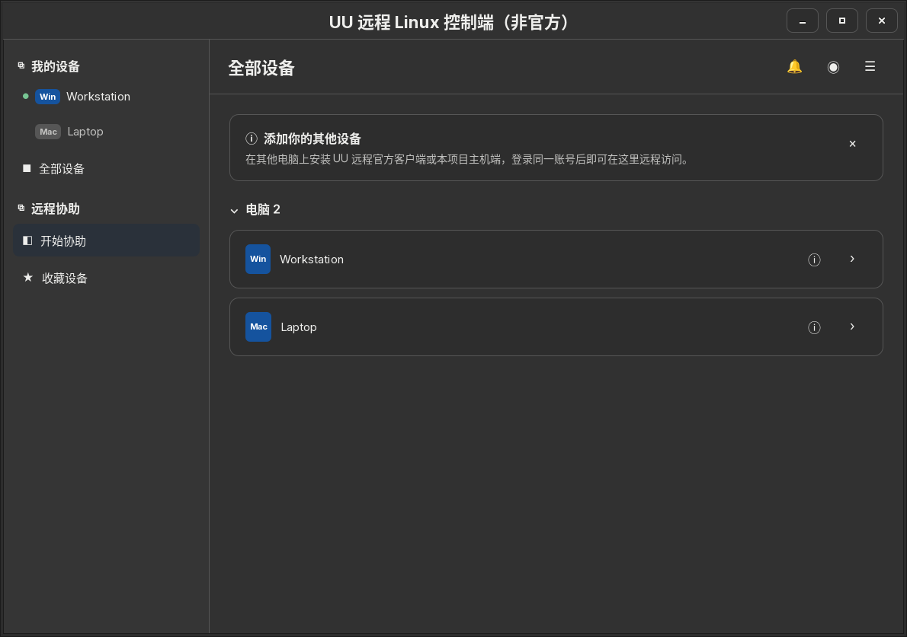
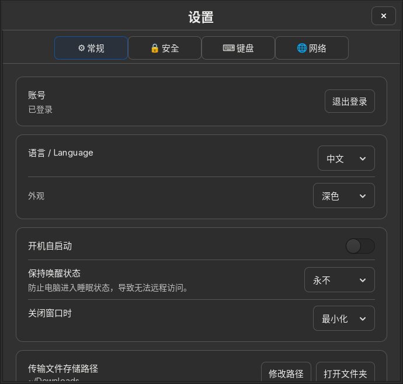

# GTK appearance validation

The host, viewer launcher, and tool windows share `c_engine/ui_theme.c`.
Layout rules stay with each window; surface, text, border, accent and status colors
come from GTK named colors. Explicit Light/Dark selects bundled Adwaita;
System releases the application override so GTK follows desktop settings again.
The preference lives in the XDG configuration directory, separately from credentials.

Appearance is inside the viewer's **Settings → General** page and the host/tool
gear settings dialogs. It is not a persistent control on the main screen.

## Synthetic previews

| Light / 浅色 | Dark / 深色 |
| --- | --- |
|  |  |

Appearance is in Settings / 外观选项位于设置中：



## Automated offline checks

Requires a C compiler, GTK3 development headers, Xvfb and xauth:

```sh
xvfb-run -a -s '-screen 0 1600x1200x24' sh tests/gtk-ui-smoke.sh /tmp/gtk-ui-previews
```

This compiles the actual GTK window implementations with fixture data, in an
isolated temporary home/config directory. No Rust host, login, network peer, QR
code, personal files or real device names are used. Tests cover:

- Host, viewer, files, port mapping and terminal list windows.
- Chinese and English with persisted System, Light and Dark choices.
- Main screens without a visible appearance selector; opening settings to switch.
- Immediate GTK preference changes, saved choices and returning to System.
- Fatal GTK/CSS warnings and blank/screen-clipped preview detection, with bounded
  repaint retries for slower CI runners.

PNG previews include main windows and their settings. CI uploads them as
`gtk-ui-previews`; they contain only synthetic data.

## Manual desktop checks

- In System mode, change the desktop's GTK theme while the app is running.
- Check keyboard focus, disabled buttons, hover, selected file rows and menus in
  both explicit themes. Check settings with a larger desktop font/scale as well.
- Restart another host/viewer process and verify it reads the saved preference.
- Verify a real QR remains readable on its white image background locally;
  never include real QR codes or account information in screenshots or reports.

Theme selection does not alter remote pixels or the SDL desktop HUD.
